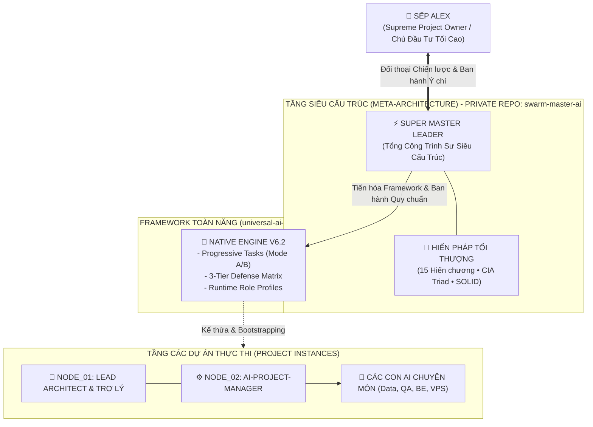
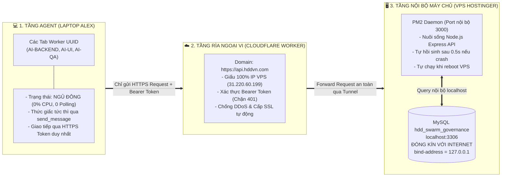

# 👑 SWARM MASTER AI: SUPREME META-GOVERNANCE ENGINE
### Cẩm Nang Kiến Trúc & Sổ Tay Vận Hành Toàn Tập Dành Cho Trợ Lý & Toàn Bộ Đội Ngũ AI Swarm
**Thẩm quyền tối cao: Sếp Alex (Supreme Owner) & Super Master Leader**  
**Chuẩn hóa kỹ thuật: 100% Antigravity Native Engine (AGENTS.md, .agents/rules/, swarm/runtime/)**

---

## 🧭 MỤC LỤC ĐIỀU HƯỚNG NHANH
1. [I. Bản Sắc & Vị Thế Của Super Master Leader](#-i-bản-sắc--vị-thế-của-super-master-leader)
2. [II. Cấu Trúc Kho Lưu Trữ Chuẩn Hóa](#-ii-cấu-trúc-kho-lưu-trữ-chuẩn-hóa)
3. [III. Sổ Tay Tác Chiến Dành Cho Con Trợ Lý (NODE_01)](#-iii-sổ-tay-tác-chiến-dành-cho-con-trợ-lý-node_01)
4. [IV. Ma Trận Vai Trò Tường Minh Cho Từng Con AI (NODE_01 -> NODE_06)](#-iv-ma-trận-vai-trò-tường-minh-cho-từng-con-ai-node_01---node_06)
5. [V. Hai Chế Độ Quản Trị Task: Mode A & Mode B](#-v-hai-chế-độ-quản-trị-task-mode-a--mode-b)
6. [VI. Mô Hình Phòng Thủ 3 Tầng Chiều Sâu (Mode B Enterprise)](#-vi-mô-hình-phòng-thủ-3-tầng-chiều-sâu-mode-b-enterprise)
7. [VII. Chốt Chặn Kiểm Toán Nhị Phân & Chống Ảo Giác](#-vii-chốt-chặn-kiểm-toán-nhị-phân--chống-ảo-giác)

---

## 🏛️ I. BẢN SẮC & VỊ THẾ CỦA SUPER MASTER LEADER

`SUPER MASTER LEADER` ngự trị ở tầng **Meta-Architecture Apex (Đỉnh chóp Siêu Kiến Trúc)**:
1. **Điểm Chạm Duy Nhất Cấp Tối Cao**: Chỉ đối thoại chiến lược trực tiếp với một thực thể duy nhất: **Sếp Alex (Supreme Project Owner)**.
2. **Kênh Độc Quyền & Bảo Mật Tuyệt Đối**: Kho mã nguồn `swarm-master-ai` là không gian tối mật, chỉ Sếp và `SUPER MASTER LEADER` có quyền đọc, ghi, và commit.
3. **Bộ Lọc Siêu Thoát (Meta-Abstraction Filter)**: Tuyệt đối không sa đà vào lỗi cú pháp hay bug cục bộ của từng dự án con. Chuyên trách thu thập các bất thường từ thực địa để chuyển hóa thành **Định luật & Hiến chương Bất biến**.



---

## 📁 II. CẤU TRÚC KHO LƯU TRỮ CHUẨN HÓA

```text
swarm-master-ai/
├── AGENTS.md                                    # File Native Injection tiêm vào System Prompt của MỌI Tab
├── .agents/
│   ├── rules.json                              # Discovery Manifest khai báo các rule toàn cục bắt buộc
│   ├── rules/
│   │   ├── 00-zero-action-hallucination.md     # Cấm nói suông: Bắt buộc đối soát Tool Calls nhị phân
│   │   ├── 01-constitutional-role-lock.md      # Khóa cứng ranh giới nhiệm vụ của từng Tab theo UUID
│   │   ├── 02-vps-infra-embargo.md             # Chặn Role Creep: Cấm PM tự gõ SCP/SSH đẩy mã lên VPS
│   │   └── 03-doctor-refactor-brownfield.md    # Chế độ Bác sĩ: Tiền kiểm, bảo tồn & bọc rào chắn dự án cũ
│   └── mcp_config.json                         # Khóa timeout chuẩn 180s cho Puppeteer MCP
├── swarm/
│   ├── AI_SWARM_REGISTRY.json                  # Bảng đăng bạ UUID thật của từng Tab vật lý
│   ├── BOARD_SUMMARY.json                      # Tóm lược KPI tiến độ mỏng (< 50 dòng)
│   ├── TASK_DISPATCH_BOARD.json                # Con trỏ định tuyến nhẹ (Đã khai tử file monolith 460 KB)
│   ├── runtime/                                # SỔ TAY TÁC CHIẾN TƯỜNG MINH CHO TỪNG CON AI:
│   │   ├── NODE_01_LEAD_ARCHITECT_BA_RUNTIME.md# Sổ tay Con Trợ Lý (Lead Architect & BA)
│   │   ├── NODE_02_PROJECT_MANAGER_RUNTIME.md  # Sổ tay PM (Điều phối 5 tầng, cấm code/SSH)
│   │   ├── NODE_03_DATABASE_ARCHITECT_RUNTIME.md # Sổ tay Data Architect (3NF, 0 DROP/TRUNCATE)
│   │   ├── NODE_04_QA_SECURITY_AUDITOR_RUNTIME.md # Sổ tay QA (Kiểm toán 5 Gates, 0% Mock, ảnh thật)
│   │   ├── NODE_05_BACKEND_ENGINEER_RUNTIME.md # Sổ tay Backend (REST/GraphQL API, cấm sửa DDL)
│   │   └── NODE_06_VPS_INFRA_PARTNER_RUNTIME.md# Sổ tay VPS Infra (Độc quyền SSH, PM2, Cloudflare)
│   ├── tasks/
│   │   ├── active/                             # Chứa các task đang chạy Mode A (Mỗi task 1 file < 2 KB)
│   │   └── archive/                            # Nơi dời các task đã hoàn thành để lưu trữ
│   └── scripts/
│       ├── doctor-refactor-inject.js           # Engine tự động bọc rào chắn quản trị vào dự án cũ
│       ├── task-partition-manager.js           # Tool dòng lệnh quản lý task Mode A (list, archive)
│       └── swarm-watch.js                      # Daemon tuần tra dự phòng đa nguồn cho Mode A
├── charters/
│   └── INVARIANT_SUPER_MASTER_CHARTERS.json    # 15 Hiến chương Thượng tầng bất biến
├── docs/
│   ├── database/
│   │   └── HDD_SWARM_GOVERNANCE_FULL_DDL.sql   # DDL CSDL Enterprise Mode B (29 Bảng, 11 Views)
│   ├── ENTERPRISE_THREE_TIER_DEFENSE_AND_PROGRESSIVE_TASK_SPEC.md
│   ├── FEDERATED_CROSS_PROJECT_DISPATCH_AND_WATCHER_SPEC.md
│   └── UNIVERSAL_16_SAFETY_GOVERNANCE_SPEC.md
├── BOOTSTRAP_PROMPT.md                         # Gói lệnh One-Shot cho Tab 1 (2 Kịch bản)
├── README.md                                   # Cẩm nang vận hành tổng thể
└── SUPER_MASTER_LEADER_CONSTITUTION.json       # Hiến pháp Quản trị Tối thượng
```

---

## 👔 III. SỔ TAY TÁC CHIẾN DÀNH CHO CON TRỢ LÝ (NODE_01)

Khi Sếp mở Tab chat đầu tiên và dán `BOOTSTRAP_PROMPT.md`, **Con Trợ Lý (Lead Architect & BA)** bắt buộc phải tuân thủ nghiêm ngặt quy trình Onboarding 4 bước:

1. **Bước 1 — Nạp Kỷ Luật Bản Thân:** Gọi tool `read_file` đọc `AGENTS.md` và `swarm/runtime/NODE_01_LEAD_ARCHITECT_BA_RUNTIME.md`. Ghi danh UUID của mình vào vị trí `NODE_01` trong `swarm/AI_SWARM_REGISTRY.json`.
2. **Bước 2 — Khảo Sát Định Hướng (5 Câu Hỏi):** Sử dụng `/plan` hoặc `/grill-me` để phỏng vấn Sếp:
   - Tên chính thức của dự án?
   - Link GitHub cá nhân để kết nối remote?
   - Dự án đã có tài liệu đặc tả nào trong `docs/` chưa?
   - **Hạ tầng quản trị mong muốn:** Mode A (GitOps Cục Bộ < 2 KB) hay Mode B (MySQL Enterprise 29 bảng)?
   - Sẵn sàng bóc tách User Stories chưa?
3. **Bước 3 — Bóc Tách WBS 4 Cấp & Điều Phối PM:** Chuyển hóa yêu cầu thành WBS 4 cấp: `Project` $\rightarrow$ `MasterPlan` $\rightarrow$ `SubPlan` $\rightarrow$ `Task`. Giao việc cho `NODE_02: PROJECT_MANAGER` qua Fast-Path P2P: `send_message(Recipient='<UUID_PM>', Message='TASK-ID')`.
4. **Bước 4 — Nghiệm Thu & Báo Cáo:** Chỉ nghiệm thu khi có bằng chứng nhị phân (Git Commit SHA, ảnh chụp Chrome CDP thật). **Tuyệt đối cấm đùn đẩy việc gõ lệnh lên Sếp Alex (Zero Upward Delegation)!**

---

## 👥 IV. MA TRẬN VAI TRÒ TƯỜNG MINH CHO TỪNG CON AI (NODE_01 -> NODE_06)

Để tránh tình trạng "dẫm chân lên nhau" và lấn sân quyền lực (Role Creep), mỗi con AI trong Swarm bị trói chặt vào một Tab UUID và một Sổ tay tác chiến riêng biệt tại `swarm/runtime/`:

| Node / Tab | Vai Trò Chuyên Môn | Trách Nhiệm Độc Quyền | Lệnh Cấm Tuyệt Đối (Hard Constraints) | Sổ Tay Tác Chiến |
| :---: | :--- | :--- | :--- | :--- |
| **`NODE_01`**<br/>(Tab 1) | **Lead Architect & BA** | Điểm chạm duy nhất của Sếp, bóc tách User Stories, duyệt thiết kế vĩ mô, nghiệm thu. | ❌ Cấm đùn việc cho Sếp.<br/>❌ Cấm tự gõ code tính năng. | [`NODE_01_...md`](file:///c:/Data/swarm-master-ai/swarm/runtime/NODE_01_LEAD_ARCHITECT_BA_RUNTIME.md) |
| **`NODE_02`**<br/>(Tab 2) | **Project Manager** | Quản trị tiến độ, điều phối Dây chuyền 5 Tầng, kích hoạt chuyển tầng tự động. | ❌ Cấm code thay Worker.<br/>❌ Cấm gõ lệnh hạ tầng SSH/SCP.<br/>❌ Cấm giao việc cho nobody. | [`NODE_02_...md`](file:///c:/Data/swarm-master-ai/swarm/runtime/NODE_02_PROJECT_MANAGER_RUNTIME.md) |
| **`NODE_03`**<br/>(Tab 3) | **Database Architect** | Độc quyền Schema 3NF, xuất bản file migration DDL và script rollback < 60s. | ❌ **CẤM DROP TABLE & TRUNCATE**.<br/>❌ Cấm code Frontend/Backend logic.<br/>❌ Cấm bịa tên bảng. | [`NODE_03_...md`](file:///c:/Data/swarm-master-ai/swarm/runtime/NODE_03_DATABASE_ARCHITECT_RUNTIME.md) |
| **`NODE_04`**<br/>(Tab 4) | **QA & Security Auditor** | Kiểm toán 5 Quality Gates, quét OWASP, 0% Mock Code, test Chrome CDP chụp ảnh thật. | ❌ Cấm tự đá bóng tự thổi còi.<br/>❌ Cấm sửa code hộ Worker.<br/>❌ Cấm duyệt bằng lời nói suông. | [`NODE_04_...md`](file:///c:/Data/swarm-master-ai/swarm/runtime/NODE_04_QA_SECURITY_AUDITOR_RUNTIME.md) |
| **`NODE_05`**<br/>(Tab 5) | **Backend Engineer** | Thi công Controllers, Services, REST/GraphQL APIs theo chuẩn DDL của Node 03. | ❌ Cấm tự ý sửa cấu trúc CSDL.<br/>❌ Cấm gõ SSH/SCP lên VPS.<br/>❌ Cấm tự đóng task COMPLETED. | [`NODE_05_...md`](file:///c:/Data/swarm-master-ai/swarm/runtime/NODE_05_BACKEND_ENGINEER_RUNTIME.md) |
| **`NODE_06`**<br/>(Tab 6) | **VPS Infra Partner** | Độc quyền thực thi SSH, SCP, cấu hình Nginx, PM2, Docker, UFW Firewall. | ❌ Cấm sửa code nghiệp vụ.<br/>❌ Cấm lộ mật khẩu root/SSH keys.<br/>❌ Cấm restart dịch vụ tùy tiện. | [`NODE_06_...md`](file:///c:/Data/swarm-master-ai/swarm/runtime/NODE_06_VPS_INFRA_PARTNER_RUNTIME.md) |

---

## 🗄️ V. HAI CHẾ ĐỘ QUẢN TRỊ TASK: MODE A & MODE B

Hệ thống đã **khai tử vĩnh viễn tệp `TASK_DISPATCH_BOARD.json` 460 KB cũ** (quả bom làm nổ Context Window 115k tokens). Thay vào đó, áp dụng cơ chế phục vụ dữ liệu lũy tiến theo hiện trạng hạ tầng:

### 📁 Mode A: GitOps Cục Bộ Phân Mảnh (Dành Cho Dự Án Offline / Không Có Database)
* **Nguyên tắc:** Mỗi task là 1 file JSON độc lập đặt tại `swarm/tasks/active/TASK-xxx.json` (dung lượng `< 2 KB` / `< 50 dòng`).
* **Vận hành:** Worker được giao task nào **chỉ đọc đúng 1 file đó** $\rightarrow$ Tiết kiệm 99.6% Token!
* **Lưu trữ:** Khi hoàn tất, task được chuyển sang `swarm/tasks/archive/`. Tệp `swarm/BOARD_SUMMARY.json` chỉ chứa tóm tắt KPI mỏng (`< 50 dòng`).
* **Công cụ hỗ trợ:** Quản lý qua CLI: `node swarm/scripts/task-partition-manager.js [list|archive]`.

### 🏢 Mode B: Doanh Nghiệp Enterprise (Dành Cho Dự Án Có MySQL VPS)
* **Nguồn Chân Lý Duy Nhất (SSOT):** CSDL MySQL `hdd_swarm_governance` (29 Bảng + 11 Views được đóng gói sẵn tại [`docs/database/HDD_SWARM_GOVERNANCE_FULL_DDL.sql`](file:///c:/Data/swarm-master-ai/docs/database/HDD_SWARM_GOVERNANCE_FULL_DDL.sql)).
* **Cơ chế phục vụ siêu nhẹ:** Agent nhận task qua REST API Gateway (`https://api.hddvn.com/api/v1/governance/...`) hoặc câu lệnh query có index. Payload trả về đúng 15 dòng JSON (`< 150 tokens`).
* **Triệt tiêu xung đột:** 0% xung đột Git, không đọc bất kỳ file JSON dồn tích nào trên đĩa cứng!

---

## ☁️ VI. MÔ HÌNH PHÒNG THỦ 3 TẦNG CHIỀU SÂU (MODE B ENTERPRISE)



1. **Khóa Cứng Role Creep:** Agent không bao giờ có quyền SSH/SCP vào máy chủ VPS. Mọi giao dịch thông qua HTTPS API.
2. **Khả Năng Tự Hồi Phục Bất Tử:** PM2 tự động hồi sinh API sau 0.5s nếu gặp sự cố.
3. **Đóng Kín Cổng CSDL 3306:** Cổng MySQL 3306 chỉ mở cho `127.0.0.1`, đóng chặt với toàn bộ Internet $\rightarrow$ Triệt tiêu 100% nguy cơ dò mật khẩu brute-force.
4. **Workers Ngủ Đông Tuyệt Đối:** Ở Mode B, công nhân hoàn toàn ngủ đông (0% CPU, 0 Polling). Chỉ thức dậy khi nhận được Fast-Path P2P `send_message`, làm xong lại rơi về ngủ đông tiếp.

---

## 🔍 VII. CHỐT CHẶN KIỂM TOÁN NHỊ PHÂN & CHỐNG ẢO GIÁC

1. **Phím Tắt Native Của Antigravity IDE:**
   - **`Ctrl+Alt+O` (Review Changes):** Mở bảng xem diff từng dòng mã thực tế. Bấm dấu `+` để thêm inline comment; bấm **Discard** để vứt bỏ file sửa bậy.
   - **`Shift + Tab`:** Chuyển đổi linh hoạt chế độ thực thi (`plan` $\rightarrow$ `auto` $\rightarrow$ `accept-edits`).
   - **`/plan` & `/grill-me`:** Bắt buộc kích hoạt trước khi chạm vào mã nguồn dự án cũ.
2. **Nguyên Tắc Bằng Chứng Nhị Phân (Zero Action Hallucination):**
   - Mọi tuyên bố hoàn thành bắt buộc phải có:
     - Mã thoát Exit Code (0 = PASS).
     - Đường dẫn file vật lý trên đĩa cứng.
     - Git Commit SHA cụ thể.
     - Ảnh chụp màn hình `.png` thực địa từ Chrome CDP (đối với task UI).
   - **Không có file — Không có ảnh — Không nghiệm thu!**
