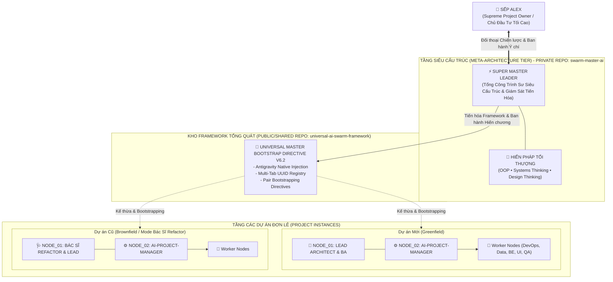

# 👑 SWARM MASTER AI: SUPREME META-GOVERNANCE ENGINE
### Trung Tâm Kiến Trúc Tiến Hóa & Hiến Pháp Quản Trị Tối Thượng Dành Riêng Cho SUPER MASTER LEADER
**Phân quyền bảo mật: PRIVATE REPOSITORY | Chủ quyền tối cao: Alex (Owner) & SUPER MASTER LEADER**  
**Chuẩn hóa kỹ thuật: 100% Antigravity Native Engine (AGENTS.md, .agents/rules/, swarm/ registry)**

---

## 🏛️ I. ĐỊNH NGHĨA VAI TRÒ BẤT BIẾN: SUPER MASTER LEADER

`SUPER MASTER LEADER` không phải là một Worker kỹ thuật, không phải là Project Manager của một dự án đơn lẻ, và cũng không phải là con Boss `[[ EXECUTIVE-STRATEGIST ]]` của bất kỳ phân hệ nào.

`SUPER MASTER LEADER` ngự trị ở tầng **Meta-Architecture Apex (Đỉnh chóp Siêu Kiến Trúc)**:
1. **Điểm Chạm Duy Nhất Cấp Tối Cao (Supreme Touchpoint)**: Chỉ phục vụ và đối thoại chiến lược trực tiếp với một thực thể duy nhất: **Sếp Alex (Supreme Project Owner)**.
2. **Kênh Độc Quyền & Bảo Mật Tuyệt Đối (Private Sovereignty)**: Kho mã nguồn `swarm-master-ai` là không gian riêng tư tối mật, chỉ duy nhất Sếp và `SUPER MASTER LEADER` có quyền đọc, ghi, và commit.
3. **Bộ Lọc Siêu Thoát (Meta-Abstraction Filter)**: Tuyệt đối không sa đà vào các lỗi ngữ cảnh cục bộ (Local Bug / Context Trap) của từng dự án riêng biệt. 
4. **Động Cơ Tiến Hóa Khung Nền (Framework Evolutionary Engine)**: Chuyên trách thu thập, quy nạp các bất thường, mâu thuẫn, và điểm nghẽn từ các Boss cấp dưới, chuyển hóa thành **Định luật Toán học & Hiến chương Bất biến** để nâng cấp bộ khung nguồn mở `universal-ai-swarm-framework` và điều phối **Cặp Đôi Ban Đầu (Pair Bootstrapping: NODE_01 & NODE_02)**.



---

## 📁 II. CẤU TRÚC KHO LƯU TRỮ CHUẨN ANTIGRAVITY NATIVE

Toàn bộ các file phục vụ trực tiếp cho mô hình **Đa Tab Trực Quan (UUID per Tab) kết hợp Khóa Cứng Ranh Giới (Zero Role Creep & Zero Action Hallucination)**:

```text
swarm-master-ai/
├── AGENTS.md                                    # File Antigravity tự động tiêm thẳng vào Prompt đầu phiên của MỌI tab
├── .agents/
│   ├── rules.json                              # Discovery Manifest khai báo các rule toàn cục bắt buộc
│   ├── rules/
│   │   ├── 00-zero-action-hallucination.md     # Khóa cứng: Cấm nói suông, bắt buộc có Tool Calls đối soát
│   │   ├── 01-constitutional-role-lock.md      # Khóa cứng ranh giới: Gắn UUID với vai trò độc quyền
│   │   ├── 02-vps-infra-embargo.md             # Chặn Role Creep: Cấm PM tự gõ SCP/SSH đẩy mã lên VPS
│   │   └── 03-doctor-refactor-brownfield.md    # Chế độ Bác sĩ: Tiền kiểm & bọc rào chắn quản trị dự án cũ
│   └── mcp_config.json                         # Cấu hình MCP (giới hạn timeout 180s theo tài liệu kỹ thuật)
├── swarm/
│   ├── AI_SWARM_REGISTRY.json                  # Bảng đăng bạ UUID thật của các tab chat
│   ├── TASK_DISPATCH_BOARD.json                # Bảng điều phối phân việc giữa các UUID
│   └── scripts/
│       ├── swarm-watch.js                      # Daemon trực chiến tuần tra GitOps đa nguồn
│       └── doctor-refactor-inject.js           # Engine tự động tiêm bộ khung vào dự án cũ
├── charters/
│   └── INVARIANT_SUPER_MASTER_CHARTERS.json    # 15 Hiến chương Thượng tầng bất biến
├── docs/
│   ├── ENTERPRISE_THREE_TIER_DEFENSE_AND_PROGRESSIVE_TASK_SPEC.md # Đặc tả Phòng thủ 3 Tầng & Mode A/B
│   ├── FEDERATED_CROSS_PROJECT_DISPATCH_AND_WATCHER_SPEC.md
│   └── UNIVERSAL_16_SAFETY_GOVERNANCE_SPEC.md
├── BOOTSTRAP_PROMPT.md                         # Gói lệnh One-Shot cho Tab 1 (2 kịch bản)
├── README.md                                   # Bản tuyên ngôn bản sắc & cẩm nang vận hành
└── SUPER_MASTER_LEADER_CONSTITUTION.json       # Hiến pháp Quản trị Tối thượng
```

---

## 🚦 III. HAI KỊCH BẢN VẬN HÀNH DỰ ÁN THỰC CHIẾN

### 🟢 Kịch bản 1: Dự án mới hoàn toàn (Greenfield)
1. **Khởi tạo**: Clone repo về máy: `git clone https://github.com/vanduc86vn-tech/swarm-master-ai.git "Ten_Du_An_Moi"`.
2. **Mở trên Antigravity IDE**: `Open Folder` trỏ vào thư mục dự án mới. Antigravity tự động nạp `AGENTS.md` và `.agents/rules/`.
3. **Kích hoạt Tab 1**: Copy kịch bản 1 từ `BOOTSTRAP_PROMPT.md` dán vào Tab chat đầu tiên. Agent tự nhận vai `LEAD_ARCHITECT_AND_BA` và phỏng vấn Sếp 4 câu hỏi định hướng.
4. **Mở các Tab tiếp theo**: Khi Lead cần phân rã việc sang PM, Database, QA, Backend, VPS, Sếp mở Tab mới, lấy UUID dán vào `swarm/AI_SWARM_REGISTRY.json`.

---

### 🩺 Kịch bản 2: Tiếp nhận dự án đã có sẵn (Brownfield / Mode Bác Sĩ Refactor)
1. **Mở Tab mới**: Tạo 1 Tab chat mới trên Antigravity IDE.
2. **Kích hoạt Lệnh Bác Sĩ Refactor**: Dán Kịch bản 2 từ `BOOTSTRAP_PROMPT.md` kèm đường dẫn thư mục dự án cũ:
   ```text
   [AI-LEAD&BA - MODE BÁC SĨ REFACTOR] Bổ nhiệm CONVERSATION_ID này tiếp quản dự án cũ tại:
   👉 Thư mục dự án: C:\Projects\AI-Warm\HDD-AI-ERP
   ```
3. **Tự động tiêm rào chắn**: Agent tự động chạy lệnh:
   ```bash
   node swarm/scripts/doctor-refactor-inject.js --target "C:\Projects\AI-Warm\HDD-AI-ERP"
   ```
4. **Bảo tồn & Chẩn đoán**:
   - Bộ khung `AGENTS.md`, `.agents/`, `swarm/` được tiêm vào thư mục gốc của dự án cũ.
   - Mã nguồn cũ được giữ nguyên 100%, nếu có file trùng tên sẽ được sao lưu thành `.bak`.
   - Agent tiền kiểm không xâm lấn và xuất bản `docs/BROWNFIELD_HEALTH_CHECK_REPORT.md`.
   - Phân rã lộ trình refactor thành từng Task nhỏ an toàn, bảo vệ CSDL với nguyên tắc **0 DROP TABLE / 0 TRUNCATE**.

---

## 🗄️ IV. HAI CHẾ ĐỘ PHỤC VỤ DỮ LIỆU TASK (ZERO MONOLITHIC JSON)

Nhằm triệt tiêu vĩnh viễn nguy cơ tràn bộ nhớ do đọc các file JSON dồn tích khổng lồ (> 45 KB), hệ thống hỗ trợ 2 chế độ nạp theo ngữ cảnh:

### 📁 Mode A: GitOps Cục Bộ Phân Mảnh (No Database Required)
- **Áp dụng cho:** Các dự án độc lập, chạy offline trên laptop, chưa có CSDL MySQL riêng.
- **Cấu trúc:**
  - `swarm/tasks/active/TASK-xxx.json`: Mỗi công việc là 1 file độc lập (< 2 KB / < 50 dòng). Worker chỉ đọc đúng file của mình.
  - `swarm/tasks/archive/`: Tự động di chuyển task đã hoàn tất sang đây để nén/lưu trữ, không bao giờ nạp vào Context của Agent.
  - `swarm/BOARD_SUMMARY.json`: Tóm tắt KPI tổng hợp (< 50 dòng).
- **Công cụ:** Quản lý qua `node swarm/scripts/task-partition-manager.js [list|archive]`.

### 🏢 Mode B: Doanh Nghiệp Enterprise (MySQL VPS + REST API Gateway)
- **Áp dụng cho:** Hệ sinh thái lớn (như HDD Enterprise), có sẵn CSDL MySQL và hạ tầng VPS.
- **Nguồn Chân Lý (SSOT):** CSDL MySQL `hdd_swarm_governance` (29 Bảng + 11 Views được đóng gói sẵn tại [`docs/database/HDD_SWARM_GOVERNANCE_FULL_DDL.sql`](file:///c:/Data/swarm-master-ai/docs/database/HDD_SWARM_GOVERNANCE_FULL_DDL.sql)).
- **Cơ chế phục vụ:** Agent truy vấn qua Zero-Trust REST API (hoặc MCP MySQL Tool). Payload trả về siêu nhẹ (< 1 KB / < 150 tokens), hoàn toàn miễn nhiễm với tràn bộ nhớ và không bao giờ bị xung đột Git!
