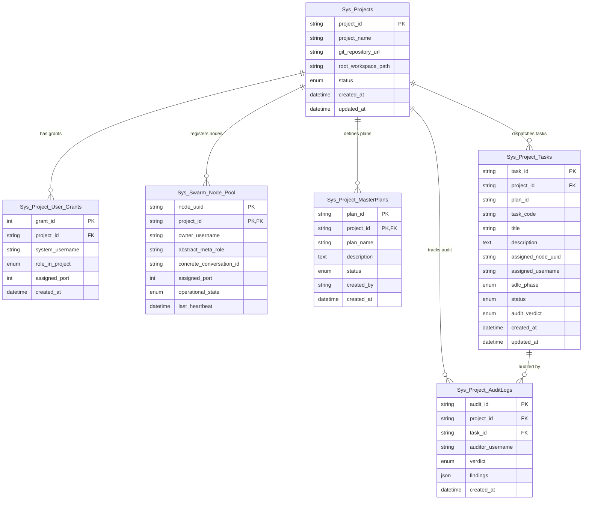

# 🗄️ UNIVERSAL MULTI-TENANT CLEAN DATABASE DDL & MOCK SEEDS (V6.1)
### Master Multi-Tenant Database Schema cho Universal AI Swarm Framework

> **Database Engine mục tiêu**: MySQL 8.0+ / MariaDB 10.5+  
> **Character Set & Collation**: `utf8mb4` / `utf8mb4_unicode_ci`  
> **Tên CSDL Mặc Định**: `sys_swarm_framework`  
> **Mục tiêu**: Chuẩn hóa cấu trúc CSDL Đa Dự Án (Multi-Tenant Swarm Engine), quản lý danh mục Dự án vật lý, tài khoản người dùng, Swarm Node Pool động và Bảng điều phối Task SSOT Runtime.

---

## 🏛️ CẤU TRÚC 6 BẢNG DỮ LIỆU CỐT LÕI (CORE TABLES)



---

## 📜 NỘI DUNG DDL SQL HOÀN CHỈNH & MOCK SEEDS

File mã nguồn SQL độc lập có thể nạp trực tiếp qua:
```bash
mysql -u root -p < templates/UNIVERSAL_MULTI_TENANT_SCHEMA_DDL_SEEDS.sql
```

Nội dung chi tiết:
```sql
CREATE DATABASE IF NOT EXISTS `sys_swarm_framework` DEFAULT CHARACTER SET utf8mb4 COLLATE utf8mb4_unicode_ci;
USE `sys_swarm_framework`;

SET FOREIGN_KEY_CHECKS = 0;

-- 1. BẢNG MASTER PROJECTS (DỰ ÁN VẬT LÝ MULTI-TENANT)
DROP TABLE IF EXISTS `Sys_Projects`;
CREATE TABLE `Sys_Projects` (
    `project_id` VARCHAR(64) NOT NULL COMMENT 'Mã định danh Tenant (VD: HDD-CLOUD, SHOP-ERP)',
    `project_name` VARCHAR(255) NOT NULL COMMENT 'Tên hiển thị dự án',
    `git_repository_url` VARCHAR(512) DEFAULT NULL COMMENT 'URL Git Repository',
    `root_workspace_path` VARCHAR(512) NOT NULL COMMENT 'Đường dẫn thư mục làm việc vật lý (/var/www/${PROJECT_ID})',
    `status` ENUM('ACTIVE', 'ARCHIVED', 'PAUSED') NOT NULL DEFAULT 'ACTIVE',
    `created_at` DATETIME NOT NULL DEFAULT CURRENT_TIMESTAMP,
    `updated_at` DATETIME NOT NULL DEFAULT CURRENT_TIMESTAMP ON UPDATE CURRENT_TIMESTAMP,
    PRIMARY KEY (`project_id`)
) ENGINE=InnoDB DEFAULT CHARSET=utf8mb4 COLLATE=utf8mb4_unicode_ci COMMENT='Quản lý danh mục Dự Án Đa Tenant';

-- 2. BẢNG ĐĂNG BẠ PHÂN QUYỀN TÀI KHOẢN (USER GRANTS PER TENANT)
DROP TABLE IF EXISTS `Sys_Project_User_Grants`;
CREATE TABLE `Sys_Project_User_Grants` (
    `grant_id` INT AUTO_INCREMENT PRIMARY KEY,
    `project_id` VARCHAR(64) NOT NULL,
    `system_username` VARCHAR(64) NOT NULL COMMENT 'Linux user thao tác (dev_nam, dev_hung...)',
    `role_in_project` ENUM('CHIEF', 'LEADER', 'DEVELOPER', 'AUDITOR') NOT NULL DEFAULT 'DEVELOPER',
    `assigned_port` INT DEFAULT NULL COMMENT 'Port Remote Control iPhone (7000-70xx)',
    `created_at` DATETIME NOT NULL DEFAULT CURRENT_TIMESTAMP,
    CONSTRAINT `fk_spug_project` FOREIGN KEY (`project_id`) REFERENCES `Sys_Projects` (`project_id`) ON DELETE CASCADE ON UPDATE CASCADE,
    UNIQUE KEY `uk_project_user` (`project_id`, `system_username`)
) ENGINE=InnoDB DEFAULT CHARSET=utf8mb4 COLLATE=utf8mb4_unicode_ci COMMENT='Quản lý cấp quyền Đa tài khoản cho từng Dự án';

-- 3. BẢNG SWARM NODE POOL (ĐĂNG BẠ ĐỘNG WORKER NODES)
DROP TABLE IF EXISTS `Sys_Swarm_Node_Pool`;
CREATE TABLE `Sys_Swarm_Node_Pool` (
    `node_uuid` VARCHAR(64) NOT NULL,
    `project_id` VARCHAR(64) NOT NULL,
    `owner_username` VARCHAR(64) NOT NULL COMMENT 'Linux user sở hữu node',
    `abstract_meta_role` VARCHAR(100) NOT NULL COMMENT 'Tên vai trò kế thừa (VD: NODE_01, NODE_02, CoderWorker)',
    `concrete_conversation_id` VARCHAR(128) DEFAULT NULL COMMENT 'Session UUID Antigravity',
    `assigned_port` INT DEFAULT NULL COMMENT 'Port Remote Control Safari iPhone',
    `operational_state` ENUM('ACTIVE_DUTY', 'STANDBY_REST', 'SUSPENDED') NOT NULL DEFAULT 'STANDBY_REST',
    `last_heartbeat` DATETIME DEFAULT NULL,
    PRIMARY KEY (`node_uuid`, `project_id`),
    CONSTRAINT `fk_sys_node_project` FOREIGN KEY (`project_id`) REFERENCES `Sys_Projects` (`project_id`) ON DELETE CASCADE ON UPDATE CASCADE
) ENGINE=InnoDB DEFAULT CHARSET=utf8mb4 COLLATE=utf8mb4_unicode_ci COMMENT='Registry động quản lý Swarm Nodes theo Tenant';

-- 4. BẢNG MASTER PLANS (KẾ HOẠCH TỔNG THỂ DỰ ÁN)
DROP TABLE IF EXISTS `Sys_Project_MasterPlans`;
CREATE TABLE `Sys_Project_MasterPlans` (
    `plan_id` VARCHAR(64) NOT NULL,
    `project_id` VARCHAR(64) NOT NULL,
    `plan_name` VARCHAR(255) NOT NULL,
    `description` TEXT,
    `status` ENUM('DRAFT', 'ACTIVE', 'PAUSED', 'COMPLETED', 'ARCHIVED') NOT NULL DEFAULT 'DRAFT',
    `created_by` VARCHAR(64) NOT NULL DEFAULT 'AI-PROJECT-MANAGER',
    `created_at` DATETIME NOT NULL DEFAULT CURRENT_TIMESTAMP,
    `updated_at` DATETIME NOT NULL DEFAULT CURRENT_TIMESTAMP ON UPDATE CURRENT_TIMESTAMP,
    PRIMARY KEY (`plan_id`, `project_id`),
    CONSTRAINT `fk_mp_sys_project` FOREIGN KEY (`project_id`) REFERENCES `Sys_Projects` (`project_id`) ON DELETE CASCADE ON UPDATE CASCADE
) ENGINE=InnoDB DEFAULT CHARSET=utf8mb4 COLLATE=utf8mb4_unicode_ci COMMENT='Bảng Kế hoạch Tổng thể theo Tenant';

-- 5. BẢNG PROJECT TASKS (BẢNG QUẢN TRỊ TASK CHÍNH - SSOT RUNTIME)
DROP TABLE IF EXISTS `Sys_Project_Tasks`;
CREATE TABLE `Sys_Project_Tasks` (
    `task_id` VARCHAR(64) NOT NULL,
    `project_id` VARCHAR(64) NOT NULL,
    `plan_id` VARCHAR(64) DEFAULT NULL,
    `task_code` VARCHAR(64) NOT NULL COMMENT 'Mã Task chuẩn (VD: TASK-AUTH-01)',
    `title` VARCHAR(255) NOT NULL,
    `description` TEXT,
    `assigned_node_uuid` VARCHAR(64) DEFAULT NULL,
    `assigned_username` VARCHAR(64) DEFAULT NULL,
    `sdlc_phase` ENUM('SURVEY_DDL', 'SCHEMA_MIGRATION', 'QA_AUDIT', 'BACKEND_API', 'CLIENT_UI', 'DEVOPS_INFRA') NOT NULL,
    `status` ENUM('TODO', 'ASSIGNED', 'IN_PROGRESS', 'REVIEW', 'DONE', 'FAILED') NOT NULL DEFAULT 'TODO',
    `audit_verdict` ENUM('NONE', 'PASSED', 'FAILED', 'WARNING') NOT NULL DEFAULT 'NONE',
    `created_at` DATETIME NOT NULL DEFAULT CURRENT_TIMESTAMP,
    `updated_at` DATETIME NOT NULL DEFAULT CURRENT_TIMESTAMP ON UPDATE CURRENT_TIMESTAMP,
    PRIMARY KEY (`task_id`),
    CONSTRAINT `fk_sys_task_project` FOREIGN KEY (`project_id`) REFERENCES `Sys_Projects` (`project_id`) ON DELETE CASCADE ON UPDATE CASCADE,
    INDEX `idx_sys_tenant_lifecycle` (`project_id`, `sdlc_phase`, `status`)
) ENGINE=InnoDB DEFAULT CHARSET=utf8mb4 COLLATE=utf8mb4_unicode_ci COMMENT='Bảng Task Runtime dùng chung cho Swarm Multi-Tenant';

-- 6. BẢNG AUDIT LOGS (NHẬT KÝ KIỂM THỬ CHẤT LƯỢNG SYSTEM)
DROP TABLE IF EXISTS `Sys_Project_AuditLogs`;
CREATE TABLE `Sys_Project_AuditLogs` (
    `audit_id` VARCHAR(64) NOT NULL PRIMARY KEY,
    `project_id` VARCHAR(64) NOT NULL,
    `task_id` VARCHAR(64) NOT NULL,
    `auditor_username` VARCHAR(64) NOT NULL,
    `verdict` ENUM('PASSED', 'FAILED', 'WARNING') NOT NULL,
    `findings` JSON NOT NULL,
    `created_at` DATETIME NOT NULL DEFAULT CURRENT_TIMESTAMP,
    CONSTRAINT `fk_audit_project` FOREIGN KEY (`project_id`) REFERENCES `Sys_Projects` (`project_id`) ON DELETE CASCADE ON UPDATE CASCADE,
    CONSTRAINT `fk_audit_task` FOREIGN KEY (`task_id`) REFERENCES `Sys_Project_Tasks` (`task_id`) ON DELETE CASCADE ON UPDATE CASCADE
) ENGINE=InnoDB DEFAULT CHARSET=utf8mb4 COLLATE=utf8mb4_unicode_ci COMMENT='Nhật ký Audit chất lượng công việc';

SET FOREIGN_KEY_CHECKS = 1;

-- SEED MOCK DATA
INSERT INTO `Sys_Projects` (`project_id`, `project_name`, `git_repository_url`, `root_workspace_path`, `status`) VALUES
('HDD-CLOUD', 'Hệ Thống HDD Cloud Swarm Engine', 'https://github.com/vanduc86vn-tech/HDD-AI-ERP', '/var/www/shared-project/HDD-CLOUD', 'ACTIVE'),
('SHOP-ERP', 'Phân Hệ Quản Lý Thượng Mại SHOP ERP', 'https://github.com/vanduc86vn-tech/SHOP-ERP', '/var/www/shared-project/SHOP-ERP', 'ACTIVE');

INSERT INTO `Sys_Project_User_Grants` (`project_id`, `system_username`, `role_in_project`, `assigned_port`) VALUES
('HDD-CLOUD', 'dev_nam', 'LEADER', 7000),
('HDD-CLOUD', 'dev_hung', 'DEVELOPER', 7001),
('SHOP-ERP', 'dev_nam', 'CHIEF', 7000);

INSERT INTO `Sys_Swarm_Node_Pool` (`node_uuid`, `project_id`, `owner_username`, `abstract_meta_role`, `concrete_conversation_id`, `assigned_port`, `operational_state`) VALUES
('NODE-01-HDD', 'HDD-CLOUD', 'dev_nam', 'NODE_01_EXECUTIVE_STRATEGIST', 'sess-uuid-001', 7000, 'ACTIVE_DUTY'),
('NODE-02-HDD', 'HDD-CLOUD', 'dev_nam', 'NODE_02_PROJECT_MANAGER', 'sess-uuid-002', 7000, 'ACTIVE_DUTY');

INSERT INTO `Sys_Project_Tasks` (`task_id`, `project_id`, `task_code`, `title`, `assigned_node_uuid`, `assigned_username`, `sdlc_phase`, `status`) VALUES
('TSK-001', 'HDD-CLOUD', 'TASK-DDL-01', 'Khởi tạo Cơ sở dữ liệu Multi-Tenant', 'NODE-02-HDD', 'dev_nam', 'SURVEY_DDL', 'DONE'),
('TSK-002', 'HDD-CLOUD', 'TASK-CONFIG-02', 'Tối ưu Cấu hình Caching Vertex AI API', 'NODE-02-HDD', 'dev_nam', 'DEVOPS_INFRA', 'IN_PROGRESS');
```
