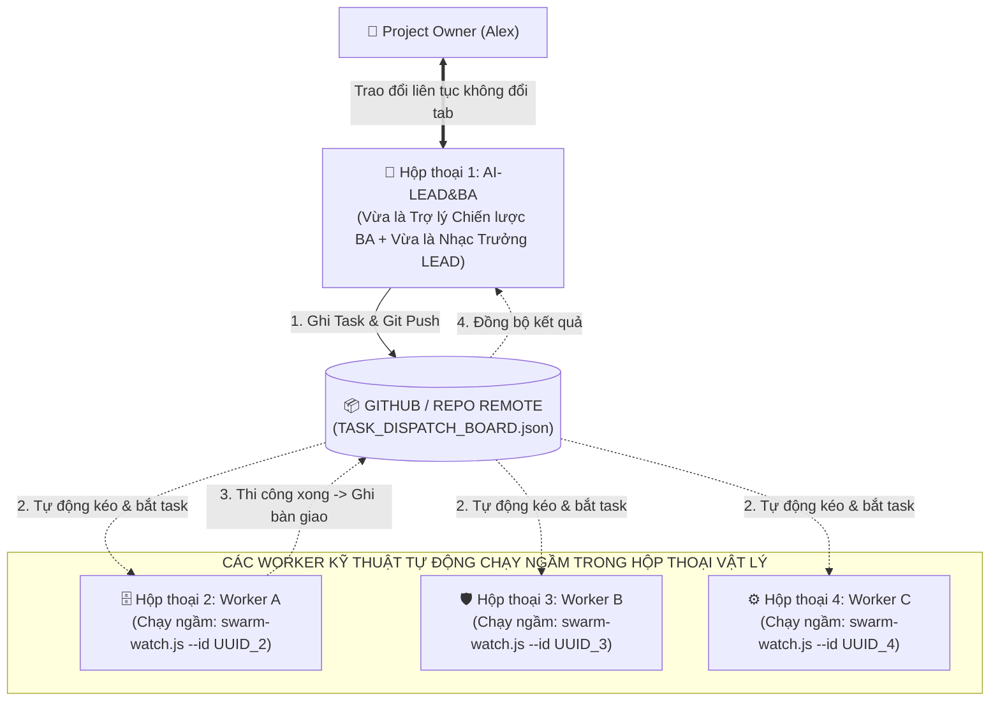

# 🚀 UNIVERSAL AI SWARM BOOTSTRAP PLAYBOOK (UASOF V3.2)
### CẨM NANG KHỞI TẠO TỔNG QUÁT: ZERO-HARDCODE GITOPS & WORKER DAEMON RUNTIME
**Dành cho Project Owner & Hệ thống AI Swarm Tự Động Hóa 100%**  
*Mã tài liệu: `UASOF-BOOTSTRAP-V3.2` | Triết lý: Dynamic UUID Binding & In-Session Physical Daemons*

---

## 🏛️ I. NGUYÊN TẮC QUẢN TRỊ BẤT BIẾN CỦA AI SWARM

Để loại bỏ hoàn toàn việc con người phải nhảy qua nhảy lại giữa các tab chat gây phân mảnh ngữ cảnh (Context Fragmentation), UASOF V3.2 thiết lập kiến trúc **Điểm Chạm Duy Nhất (Single Point of Contact - SPOC)**:



---

## 💡 II. 🚨 QUY TRÌNH KÍCH HOẠT WORKER MỚI (CHỈ COPY-PASTE, KHÔNG DÙNG TERMINAL)

Khi `AI-LEAD&BA` xác định đến giai đoạn cần mở thêm một Worker (ví dụ: AI-DATA, AI-BACKEND, AI-AUDIT), người dùng **không cần biết kỹ thuật hay gõ terminal**, chỉ thực hiện 3 thao tác copy-paste đơn giản:

### Bước 1: Mở Tab Chat Mới & Lấy Conversation ID (UUID)
1. Bấm dấu `+` trên giao diện chat IDE để mở 1 Tab Chat mới.
2. Tại tab mới, gõ đúng câu hỏi:
   ```text
   Conversation ID của phiên chat này là gì?
   ```
3. Con AI mới sẽ trả lời: `Mã Conversation ID của tôi là: <UUID_MỚI>`.
4. Người dùng copy mã UUID đó dán lại vào hộp thoại `AI-LEAD&BA` (Tab 1).

### Bước 2: AI-LEAD&BA Đăng Bạ & Xuất Khung Prompt Tự Động Kích Hoạt
1. `AI-LEAD&BA` lập tức ghi nhận UUID vào `swarm/AI_SWARM_REGISTRY.json`, `git commit` và `git push`.
2. `AI-LEAD&BA` xuất ra **đúng 1 khung văn bản mẫu (Code block)** để người dùng chỉ việc bấm nút "Copy".

### Bước 3: Dán Vào Tab Chat Mới (AI Mới Tự Kích Hoạt Daemon Ngầm)
1. Người dùng bấm nút **Copy** trên khung của `AI-LEAD&BA`, quay sang Tab chat mới, bấm **Paste** và Enter.
2. Nội dung đoạn prompt hướng dẫn con AI mới tự động gọi công cụ `run_command` chạy ngầm script daemon:
   ```text
   node swarm/scripts/swarm-watch.js --id <UUID_MỚI> --loop --interval 15
   ```
3. **Tuyệt đối người dùng không cần mở Terminal**: Chính con AI mới trong tab đó sẽ tự gọi công cụ và đưa tiến trình vào chạy ngầm!
4. Daemon tự động phân giải mã `<UUID_MỚI>` từ `AI_SWARM_REGISTRY.json` để biết vai trò của mình và bắt đầu lắng nghe Git. Khi có task mới, daemon sẽ kết thúc để hệ thống Antigravity **tự động đánh thức con AI dậy thi công ngay lập tức**!

---

## 🛰️ III. CƠ CHẾ VẬN HÀNH TỰ ĐỘNG 100% CỦA WORKER DAEMON

Sau khi bước 3 được kích hoạt:
1. **Tự Động Kéo Git (Auto Polling)**: Cứ mỗi chu kỳ, daemon tự động chạy `git pull --quiet` để cập nhật trạng thái mới nhất từ repository từ xa.
2. **Tự Động Nhận Việc (Auto Claim)**: Khi phát hiện trên `swarm/TASK_DISPATCH_BOARD.json` có task được giao cho vai trò hoặc UUID của nó:
   - Daemon tự động phát chuông báo động: `🚨 [PHÁT HIỆN TÍN HIỆU TÁC VỤ MỚI CHO <UUID>]`.
   - Con Worker trong chính tab vật lý đó tự động nhận task `IN_PROGRESS`, tự đọc yêu cầu và bắt tay vào thi công!
3. **Tự Động Bàn Giao Chéo (Autonomous Handoff)**:
   - Thi công xong, Worker tự đổi trạng thái task sang `READY_FOR_AUDIT` kèm `handoff_to: "AI-AUDIT"`, tự động `git commit` và `git push`!
   - Daemon của Worker kiểm toán ở tab khác tự động bắt được tín hiệu và tự chạy kiểm toán mà người dùng không cần bấm gì cả!
4. **Báo Cáo Tự Động Về Điểm Chạm Duy Nhất**:
   - `AI-LEAD&BA` ở Tab 1 tự động kéo kết quả từ Git về và báo cáo tóm tắt cho Alex!

---

## 💤 IV. QUY TẮC QUẢN TRỊ VÒNG ĐỜI TAB VẬT LÝ & NHỊP TIM/SLEEP (HEARTBEAT GOVERNANCE)

Để cân bằng giữa **tính phản ứng tức thì của AI** và **tài nguyên mạng / CPU của máy tính**, framework thiết lập chính sách nhịp tim chuẩn mực:

### 1. Chính Sách Nhịp Tim Động & Giới Hạn Ngủ Tối Đa 10 Phút (Max Sleep Policy)
- **Chế độ Trực chiến (Active Sprint)**: Nhịp tim `15s` - `30s`. Áp dụng khi đang trong phiên làm việc bận rộn, các Worker cần bàn giao code và test chéo liên tục.
- **Chế độ Chờ (Standby / Energy Saver)**: Nhịp tim `60s` - `300s` (1 - 5 phút). Áp dụng khi đàn AI đang chờ người dùng xem xét, phê duyệt User Stories hoặc đi ăn trưa.
- **Giới hạn trần tối đa (Hard Ceiling Cap)**: **TỐI ĐA 10 PHÚT (`600s`)**.
  > ⚠️ **Quy tắc bất biến**: Tuyệt đối không cho Worker ngủ quá 10 phút. Nếu ngủ quá lâu, độ trễ phát hiện task sẽ quá lớn, khiến toàn bộ tiến độ dự án bị nghẽn và người dùng có cảm giác hệ thống bị "chết lâm sàng".
- **Đồng bộ nhịp tim toàn đàn tự động qua Git**:
  - Khi người dùng muốn đổi chế độ (Trực chiến 15s hoặc Nghỉ 10p), `AI-LEAD&BA` chỉ cần sửa trường `"watch_interval_seconds"` trong `swarm/AI_SWARM_REGISTRY.json` và đẩy lên Git.
  - Script `swarm-watch.js` tại mỗi Worker tự động đọc giá trị này sau mỗi chu kỳ để tự điều chỉnh độ dài giấc ngủ mà người dùng không phải gõ lại lệnh ở từng tab!

### 2. Quy Tắc Vòng Đời Tab Vật Lý & Cảnh Báo Khi Tắt (Lifecycle & Shutdown Rule)
- **Cảnh báo sống còn**: **TUYỆT ĐỐI KHÔNG TẮT TAB WORKER** khi dự án đang trong giai đoạn phát triển.
- **Chỉ tắt tab khi**: Người dùng chủ động tạm ngừng dự án (Project Freeze) hoặc hoàn thành trọn vẹn Sprint/Milestone.
- **Quy trình tạm ngừng (Safe Freeze Protocol)**:
  1. Người dùng báo với `AI-LEAD&BA`: *"Tôi muốn tạm dừng dự án hôm nay"*.
  2. `AI-LEAD&BA` kiểm tra và xác nhận 100% code, tài liệu, Task Board đã được commit và push lên GitHub an toàn.
  3. Người dùng có thể yên tâm tắt các tab chat hoặc đóng IDE.
- **Quy trình kích hoạt lại (Cold Start / Resume Protocol)**:
  - Khi mở lại máy, người dùng chỉ cần mở lại tab đó và gửi câu lệnh khởi động ngầm 1-dòng:
    `git pull; node swarm/scripts/swarm-watch.js --id <UUID> --loop`
  - Worker sẽ lập tức kết nối lại với Git và tiếp tục chu kỳ trực chiến bình thường.
