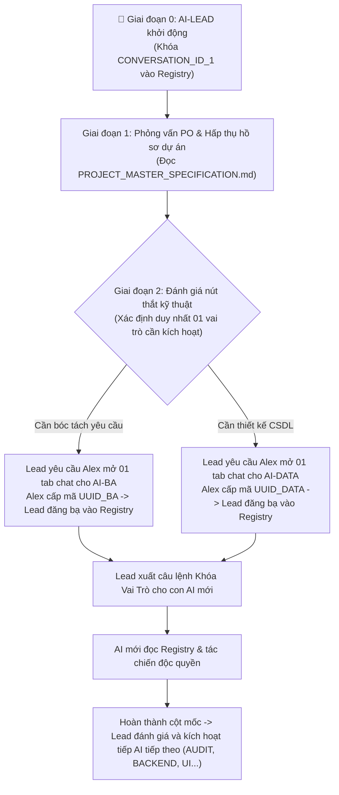

# 🚀 UNIVERSAL AI SWARM BOOTSTRAP PLAYBOOK (DYNAMIC EVOLUTION)
### CẨM NANG KHỞI TẠO TỔNG QUÁT: TỰ TIẾN HÓA ĐA TÁC TỬ THEO VÒNG ĐỜI DỰ ÁN
**Dành cho Project Owner (Alex) & AI-LEAD thế hệ mới**  
*Mã tài liệu: `UASOF-BOOTSTRAP-V2.3` | Triết lý: Dynamic UUID Binding & Just-In-Time Swarm Evolution*

---

## 🏛️ I. NGUYÊN LÝ CỐT LÕI: ĐỊNH DANH BẤT BIẾN BẰNG CONVERSATION ID (UUID)

Cơ chế quản trị duy nhất giúp Biệt đội AI Swarm không bao giờ bị "nhập nhằng vai trò", "đa nhân cách" hay "tự đá bóng tự thổi còi" là:
> **1 HỘP THOẠI CHAT = 1 SESSION CONTAINER = 1 CONVERSATION ID (UUID) DUY NHẤT = 1 VAI TRÒ BẤT BIẾN**

Toàn bộ Swarm vận hành dựa trên file sổ bộ `swarm/AI_SWARM_REGISTRY.json`. Khi bất kỳ AI nào được sinh ra, nó bắt buộc phải được gắn chặt vào một mã UUID thực tế.

---

## 🧭 II. BẢN ĐỒ TIẾN HÓA ĐỘNG TỪNG BƯỚC (DYNAMIC ONBOARDING PROTOCOL)

Thay vì tư duy Thác nước (Waterfall) cứng nhắc mở ồ ạt cả 7 AI ngay ngày đầu tiên, Swarm được tiến hóa từng bước (Just-In-Time):

---

## 📦 III. QUY TRÌNH 4 BƯỚC THỰC THI CHO AI-LEAD

### Bước 1: Khởi Động Nhạc Trưởng (AI-LEAD Setup)
1. Tải công cụ nền tảng về thư mục `swarm/` (`swarm-gc.js`, `swarm-sync.js`, `.gitignore`).
2. Tự lấy mã `Conversation ID` của chính mình và ghi vào `swarm/AI_SWARM_REGISTRY.json` với vai trò `CONVERSATION_ID_1 (AI-LEAD)`.

### Bước 2: Phỏng Vấn Ngữ Cảnh Dự Án Cụ Thể (Discovery Interview)
Vì khung UASOF là trừu tượng, AI-LEAD chủ động đặt 3 câu hỏi cho Alex:
- *Tên dự án là gì?*
- *Hồ sơ đặc tả có sẵn ở file nào (ví dụ: `PROJECT_MASTER_SPECIFICATION.md`) hay cần tóm tắt tầm nhìn?*
- *Giai đoạn hiện tại là gì?*

### Bước 3: Đề Xuất & Yêu Cầu Cấp UUID Từng Bước (JIT UUID Binding)
Dựa trên câu trả lời của Alex:
- Nếu dự án cần làm rõ nghiệp vụ $\rightarrow$ AI-LEAD đề xuất kích hoạt **`AI-BA`**.
- Nếu dự án đã có sẵn code/CSDL cần tái cấu trúc $\rightarrow$ AI-LEAD đề xuất kích hoạt **`AI-DATA`**.
- AI-LEAD yêu cầu Alex:
  > *"Xin anh mở 01 hộp thoại chat mới cho [Tên Vai Trò] và gửi mã Conversation ID (UUID) của hộp thoại đó cho tôi!"*

### Bước 4: Đăng Bạ Bất Biến & Xuất Lệnh Khóa Vai Trò
1. AI-LEAD nhận mã UUID từ Alex, ghi dòng mapping vào `swarm/AI_SWARM_REGISTRY.json`.
2. AI-LEAD sinh ra đúng **01 câu prompt định danh** để Alex dán vào hộp thoại mới. Con AI mới sẽ đọc Registry, nhận diện vị trí và kích hoạt chuyên môn độc quyền của mình.
