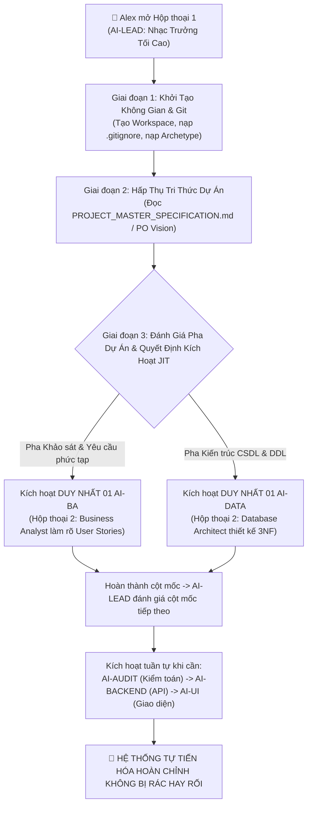

# 🚀 UNIVERSAL AI SWARM BOOTSTRAP PLAYBOOK (DYNAMIC EVOLUTION)
### CẨM NANG KHỞI TẠO TỔNG QUÁT: TỰ TIẾN HÓA ĐA TÁC TỬ THEO VÒNG ĐỜI DỰ ÁN
**Dành cho Project Owner (Alex) & AI-LEAD thế hệ mới**  
*Mã tài liệu: `UASOF-BOOTSTRAP-V2.1` | Triết lý: Systems Thinking & Just-In-Time (JIT) Swarm Evolution*

---

## 🧭 I. BẢN ĐỒ TIẾN HÓA TỰ ĐỘNG THEO VÒNG ĐỜI DỰ ÁN



---

## 📦 II. CHI TIẾT CÁC GIAI ĐOẠN TRIỂN KHAI THỰC TẾ

### GIAI ĐOẠN 1: THIẾT LẬP REPOSITORY & WORKSPACE
1. **Hành động của AI-LEAD**:
   - Khởi tạo thư mục dự án cục bộ theo chuẩn Clean Architecture:
     ```
     <project-name>/
     ├── .gitignore                  # Chặn rác, chặn scratch/ và các dump > 1MB
     ├── README.md                   # SSOT giới thiệu dự án & bản đồ điều hướng
     ├── docs/                       # Tài liệu kiến trúc & nghiệp vụ
     ├── src/                        # Mã nguồn chính thức (Frontend/Backend)
     ├── migrations/                 # DDL & SQL migrations theo thứ tự thời gian
     ├── scratch/                    # Thư mục đệm tạm thời (TTL = 48h)
     └── swarm/                      # BỘ NÃO ĐIỀU PHỐI AI SWARM
         ├── UNIVERSAL_AI_SWARM_ARCHETYPE.json   # Tầng 1: Bản mẫu trừu tượng
         ├── AI_SWARM_REGISTRY.json              # Tầng 2: Đăng bạ phân vai (Cập nhật động)
         ├── TASK_DISPATCH_BOARD.json            # Hàng đợi tác vụ thời gian thực
         └── scripts/                            # Scripts điều phối & Dọn rác GC
     ```

---

### GIAI ĐOẠN 2: HẤP THỤ TRI THỨC VÀ BỐI CẢNH DỰ ÁN (DISCOVERY)
- AI-LEAD tự động đọc các tài liệu có sẵn trong dự án: `PROJECT_MASTER_SPECIFICATION.md`, `README.md` hoặc yêu cầu từ Project Owner.
- **Nguyên tắc**: AI-LEAD tuyệt đối không tự kiêm nhiệm vai trò kỹ thuật chi tiết. Nhiệm vụ của Lead là **nhìn toàn cảnh (Systems Thinking), định vị giai đoạn hiện tại của dự án**.

---

### GIAI ĐOẠN 3: GIAO THỨC TIẾN HÓA ĐỘNG THEO NHU CẦU (JUST-IN-TIME ONBOARDING)
> [!IMPORTANT]
> **QUY TẮC VÀNG CHỐNG "HARDCODE 7 SLOTS"**:
> Không bao giờ mở ồ ạt 6-7 tab chat ngay ngày đầu tiên! Chỉ kích hoạt đúng 01 vai trò tương ứng với nút thắt cổ chai kỹ thuật hiện tại:

1. **Trường hợp 1 (Dự án cần làm rõ nghiệp vụ, User Stories)**:
   - AI-LEAD đề xuất Alex: *"Thưa anh, dự án đang ở pha khảo sát yêu cầu. Em đề xuất anh mở thêm đúng 01 hộp thoại cho **AI-BA (Business Analyst)** để cùng anh bóc tách tính năng."*
2. **Trường hợp 2 (Yêu cầu đã rõ, cần thiết kế CSDL)**:
   - AI-LEAD đề xuất Alex: *"Thưa anh, yêu cầu đã chốt. Em đề xuất anh mở thêm đúng 01 hộp thoại cho **AI-DATA (Database Architect)** để thiết kế 3NF và viết Migrations."*
3. **Các giai đoạn tiếp theo**:
   - Khi DDL hoàn tất $\rightarrow$ Kích hoạt `AI-AUDIT` để thẩm định 5 Quality Gates.
   - Khi CSDL được phê duyệt $\rightarrow$ Kích hoạt `AI-BACKEND` viết API endpoints.
   - Khi API sẵn sàng $\rightarrow$ Kích hoạt `AI-CLIENT-UI` hoặc `AI-ADMIN-UI` dựng giao diện.

---

### GIAI ĐOẠN 4: CẬP NHẬT ĐĂNG BẠ BẤT BIẾN THEO TỪNG VAI TRÒ
Mỗi khi có một vai trò mới được kích hoạt:
1. Alex mở 01 tab chat mới, lấy Conversation ID của con AI mới nộp lại cho AI-LEAD.
2. AI-LEAD cập nhật `swarm/AI_SWARM_REGISTRY.json`, gắn mã UUID mới vào Slot tương ứng.
3. AI-LEAD phát hành đúng **01 câu lệnh định danh** để Alex dán vào con AI mới. Con AI đó sẽ được khóa chặt vào vai trò độc quyền, không bao giờ xâm lấn quyền hạn của con khác.
