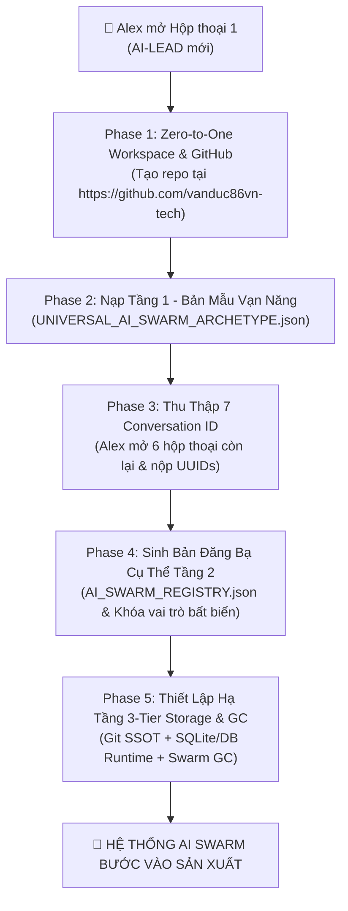

# 🚀 UNIVERSAL AI SWARM BOOTSTRAP PLAYBOOK (ZERO-TO-ONE)
### CẨM NANG KHỞI TẠO TỔNG QUÁT: TỪ REPOSITORY TRẮNG ĐẾN HỆ THỐNG BIỆT ĐỘI AI SWARM ĐA TÁC TỬ
**Dành cho Project Owner (Alex) & AI-LEAD thế hệ mới**  
*Mã tài liệu: `UASOF-BOOTSTRAP-V2.0` | Phạm vi: Mọi dự án phần mềm mới*

---

## 🧭 I. BẢN ĐỒ LỘ TRÌNH KHỞI TẠO 5 GIAI ĐOẠN (5-PHASE ROADMAP)



---

## 📦 II. CHI TIẾT 5 GIAI ĐOẠN TRIỂN KHAI TỰ ĐỘNG

### GIAI ĐOẠN 1: THIẾT LẬP REPOSITORY & WORKSPACE
1. **Đầu vào từ Alex**: Cung cấp đường dẫn GitHub profile `https://github.com/vanduc86vn-tech` và tên dự án mới (ví dụ: `new-fintech-core` hoặc `ecommerce-saas`).
2. **Hành động của AI-LEAD**:
   - Sử dụng công cụ tương tác web / browser hoặc Git CLI để kiểm tra / tạo mới Repository trên GitHub: `https://github.com/vanduc86vn-tech/<project-name>`.
   - Khởi tạo thư mục dự án cục bộ theo chuẩn Clean Architecture:
     ```
     <project-name>/
     ├── .gitignore                  # Chặn rác, chặn scratch/ và các dump > 1MB
     ├── README.md                   # SSOT giới thiệu dự án & phân công Swarm
     ├── docs/                       # Tài liệu kiến trúc & nghiệp vụ
     ├── src/                        # Mã nguồn chính thức (Frontend/Backend)
     ├── migrations/                 # DDL & SQL migrations theo thứ tự thời gian
     ├── scratch/                    # Thư mục đệm tạm thời (TTL = 48h)
     └── swarm/                      # BỘ NÃO ĐIỀU PHỐI AI SWARM
         ├── UNIVERSAL_AI_SWARM_ARCHETYPE.json   # Tầng 1: Bản mẫu trừu tượng
         ├── AI_SWARM_REGISTRY.json              # Tầng 2: Bản kế thừa cụ thể
         ├── TASK_DISPATCH_BOARD.json            # Hàng đợi tác vụ thời gian thực
         └── scripts/                            # Scripts điều phối & Dọn rác GC
     ```

---

### GIAI ĐOẠN 2: NẠP TẦNG 1 — BẢN MẪU TRỪU TƯỢNG VẠN NĂNG (TIER 1 ARCHETYPE)
AI-LEAD tự động nạp file `swarm/UNIVERSAL_AI_SWARM_ARCHETYPE.json` chứa 7 Slot chuẩn kỹ nghệ phần mềm:
- **`CONVERSATION_ID_1`** $\rightarrow$ `LEAD_ORCHESTRATOR` (AI-LEAD)
- **`CONVERSATION_ID_2`** $\rightarrow$ `DATA_ARCHITECT` (AI-1A CSDL & DDL)
- **`CONVERSATION_ID_3`** $\rightarrow$ `QA_SEC_AUDITOR` (AI-1B Kiểm toán độc lập 5 Quality Gates)
- **`CONVERSATION_ID_4`** $\rightarrow$ `BACKEND_ENGINEER` (AI-1C Dịch vụ nền tảng & API Gateway)
- **`CONVERSATION_ID_5`** $\rightarrow$ `CLIENT_PUBLIC_UI` (AI-2A Giao diện khách hàng cuối / Portal)
- **`CONVERSATION_ID_6`** $\rightarrow$ `CLIENT_ADMIN_UI` (AI-2B Giao diện quản trị nội bộ / ERP Backoffice)
- **`CONVERSATION_ID_7`** $\rightarrow$ `DOMAIN_SPECIALIST` (AI-6 Chuyên gia nghiệp vụ ngành đặc thù)

---

### GIAI ĐOẠN 3: GIAO THỨC THU THẬP CONVERSATION ID (DYNAMIC ONBOARDING)
AI-LEAD sẽ in ra màn hình bảng hướng dẫn để Alex thực hiện trong 2 phút:
1. Alex mở lần lượt 6 tab/hộp thoại mới trên IDE.
2. Tại mỗi hộp thoại, Alex chỉ cần hỏi: *"Conversation ID của mày là gì?"*
3. Alex copy 6 mã UUID gửi lại cho AI-LEAD ở hộp thoại 1.

---

### GIAI ĐOẠN 4: BIÊN DỊCH & KHÓA CỨNG BẢN ĐĂNG BẠ TẦNG 2 (`AI_SWARM_REGISTRY.json`)
AI-LEAD nhận 7 mã UUID, kết hợp với ngữ cảnh dự án do Alex cung cấp, tự động xuất file `swarm/AI_SWARM_REGISTRY.json`:
- Khóa cứng từng UUID vào 1 vai trò duy nhất.
- Xác lập ranh giới độc quyền (Exclusive Boundaries) và danh sách hành vi bị cấm.
- Xuất bộ 6 câu lệnh "khóa vai trò" để Alex dán ngược lại vào 6 hộp thoại kia.

---

### GIAI ĐOẠN 5: THIẾT LẬP HẠ TẦNG LƯU TRỮ 3 TẦNG & BỘ DỌN RÁC GC (GARBAGE COLLECTOR)
Để đảm bảo máy tính của Alex không bao giờ bị đầy ổ cứng và AI không bao giờ bị quá tải bộ nhớ:
1. **Kích hoạt [.gitignore](.gitignore) nghiêm ngặt**: Cấm tuyệt đối đưa các file nháp, dumps, `.tmp`, `scratch/` vào Git.
2. **Kích hoạt Swarm Runtime Database**: Sử dụng SQLite siêu nhẹ (`swarm/swarm_runtime.db`) để lưu trữ vết kiểm toán và log hàng đợi task thay vì xả file `.md` bừa bãi.
3. **Cài đặt kịch bản dọn rác tự động (`swarm-gc.js`)**:
   - Tự động quét và xóa sạch các file trong `scratch/` quá 48h.
   - Giữ ổ cứng Windows luôn trong trạng thái tinh gọn tối đa.

---

## ⚡ III. GÓI LỆNH MỘT CHẠM (ONE-SHOT BOOTSTRAP PROMPT)
*Khi mở hộp thoại mới, Alex chỉ cần copy toàn bộ đoạn văn bản bên dưới dán vào hộp thoại đầu tiên:*

```text
Chào AI, mày được bổ nhiệm làm CONVERSATION_ID_1 (AI-LEAD: System Architect & Swarm Orchestrator) để khởi tạo một dự án phần mềm hoàn toàn mới theo chuẩn UASOF (Universal AI Swarm Orchestration Framework).

Dưới đây là thông tin dự án:
- Chủ sở hữu dự án: Alex
- GitHub Profile: https://github.com/vanduc86vn-tech
- Tên dự án: [ĐIỀN TÊN DỰ ÁN MỚI VÀO ĐÂY, ví dụ: my-new-project]
- Mục tiêu dự án: [ĐIỀN MÔ TẢ NGẮN GỌN VỀ DỰ ÁN VÀO ĐÂY]

Nhiệm vụ của mày:
1. Đọc và kế thừa toàn bộ cấu trúc TẦNG 1: BẢN MẪU TRỪU TƯỢNG VẠN NĂNG (7 Slots: CONVERSATION_ID_1..7).
2. Kiểm tra/hướng dẫn khởi tạo GitHub repository dưới tài khoản https://github.com/vanduc86vn-tech/[tên-dự-án].
3. Tạo khung thư mục dự án chuẩn, thiết lập .gitignore chống tràn đĩa, tạo thư mục swarm/ với đầy đủ hạ tầng.
4. Xuất bảng yêu cầu thu thập 6 mã Conversation ID còn lại từ tao để gán vào AI_SWARM_REGISTRY.json.
5. Thiết lập cơ chế lưu trữ 3-Tier (Git SSOT + SQLite Runtime + Script dọn rác swarm-gc.js).

Mày đã nắm rõ vai trò Lead Orchestrator chưa? Hãy xác nhận Conversation ID của mày và bắt đầu Bước 1 ngay!
```
