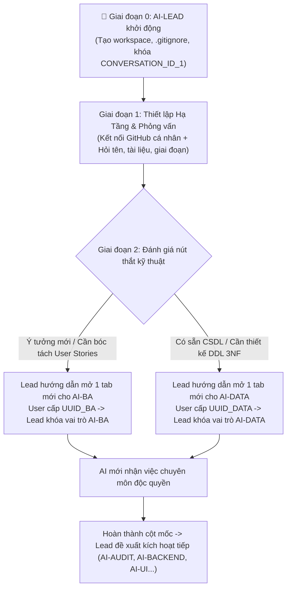

# 🚀 UNIVERSAL AI SWARM BOOTSTRAP PLAYBOOK (ENTERPRISE V2.5)
### CẨM NANG KHỞI TẠO TỔNG QUÁT: THIẾT LẬP HẠ TẦNG GITHUB CÁ NHÂN & TIẾN HÓA ĐA TÁC TỬ
**Dành cho mọi Lập trình viên, Project Owner & AI-LEAD thế hệ mới**  
*Mã tài liệu: `UASOF-BOOTSTRAP-V2.5` | Phạm vi: Mọi dự án phần mềm trên mọi máy tính*

---

## 🏛️ I. HAI TRỤ CỘT HẠ TẦNG BẮT BUỘC (MANDATORY INFRASTRUCTURE BASELINE)

Trước khi viết bất kỳ dòng mã tính năng nào, hệ thống AI Swarm bắt buộc phải hoàn thành 100% hai trụ cột hạ tầng:

### 1. Trụ Cột Git SSOT Cá Nhân Hóa (Personalized GitHub Remote)
- Mỗi dự án phần mềm phải được liên kết với một **GitHub Repository độc lập** thuộc tài khoản của chính người dùng đó (`https://github.com/<username>/<project-name>`).
- Cấu hình file `.gitignore` nghiêm ngặt để chặn đứng rác đĩa (`scratch/`, `*.dump`, `*.tmp`, database nhị phân).
- AI-LEAD có trách nhiệm hướng dẫn người dùng kết nối remote:
  ```bash
  git remote add origin https://github.com/<username>/<project-name>.git
  git push -u origin main
  ```

### 2. Trụ Cột Đăng Bạ Bất Biến Bằng Conversation ID (UUID)
- Cơ chế chống "đa nhân cách" và "xung đột vai trò":
  > **1 Hộp Thoại Chat = 1 Session Container = 1 Conversation ID (UUID) = 1 Vai Trò Độc Quyền**
- File sổ bộ SSOT: `swarm/AI_SWARM_REGISTRY.json`.

---

## 💡 II. HƯỚNG DẪN CÁCH LẤY CONVERSATION ID CỦA TAB CHAT MỚI

Khi AI-LEAD đề xuất mở thêm một tác tử mới (ví dụ: `AI-BA` hoặc `AI-DATA`), người dùng thực hiện theo 3 bước cực kỳ đơn giản:

```text
[BƯỚC 1]: Bấm dấu "+" trên IDE để mở 1 Tab Chat / Cửa Sổ Mới.
    │
    ▼
[BƯỚC 2]: Tại cửa sổ mới đó, gõ đúng câu hỏi:
    "Conversation ID của phiên chat này là gì?"
    -> Con AI mới sẽ trả lời: "Mã Conversation ID của tôi là: xxxxxxxx-xxxx-xxxx-xxxx-xxxxxxxxxxxx"
    │
    ▼
[BƯỚC 3]: Copy mã UUID đó dán lại vào hộp thoại của AI-LEAD.
    -> AI-LEAD sẽ ghi vào swarm/AI_SWARM_REGISTRY.json và xuất lệnh Khóa Vai Trò cho con AI mới đó!
```

---

## 🧭 III. QUY TRÌNH TIẾN HÓA ĐA TÁC TỬ TỪNG BƯỚC (JUST-IN-TIME ONBOARDING)



---

## 📦 IV. NGUYÊN TẮC QUẢN TRỊ FILE TRONG DỰ ÁN

| Phân Loại | Danh mục Tài nguyên | Quy Tắc Xử Lý |
| :--- | :--- | :--- |
| **🟢 Git Production SSOT** | `src/`, `migrations/*.sql`, `schema/`, `docs/`, `swarm/*.json`, `README.md` | **Bắt buộc commit & push lên GitHub** để lưu vết lịch sử |
| **🔴 Local Runtime Only** | File DDL realtime dump gộp lớn (>1MB), `swarm/swarm_runtime.db`, file chứa mật khẩu `.env` | **CẤM PUSH GIT (Đã đưa vào .gitignore)** |
| **⚡ Hot Scratchpad** | Thư mục `scratch/`, file payload `*.tmp`, `*.dump` | **Tự hủy sau 48h qua `swarm-gc.js` (100% .gitignore)** |
