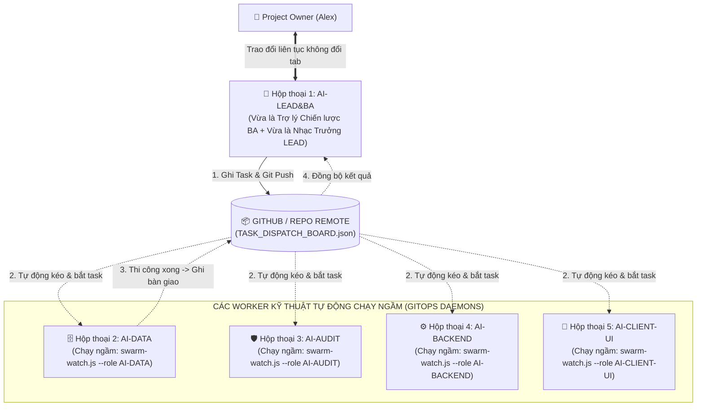

# 🚀 UNIVERSAL AI SWARM BOOTSTRAP PLAYBOOK (UASOF V3.1)
### CẨM NANG KHỞI TẠO TỔNG QUÁT: MÔ HÌNH CO-PILOT KÉP (AI-LEAD&BA) & GITOPS WORKER DAEMONS
**Dành cho Project Owner & Hệ thống AI Swarm Tự Động Hóa 100%**  
*Mã tài liệu: `UASOF-BOOTSTRAP-V3.1` | Triết lý: Single Point of Contact & Autonomous GitOps Daemons*

---

## 🏛️ I. NGUYÊN TẮC QUẢN TRỊ BẤT BIẾN CỦA AI SWARM

Để loại bỏ hoàn toàn việc con người phải nhảy qua nhảy lại giữa các tab chat gây phân mảnh ngữ cảnh (Context Fragmentation), UASOF V3.1 thiết lập kiến trúc **Điểm Chạm Duy Nhất (Single Point of Contact - SPOC)**:



---

## 💡 II. 🚨 VẤN ĐỀ SỐNG CÒN: QUY TRÌNH KÍCH HOẠT MỘT WORKER MỚI

Khi `AI-LEAD&BA` thông báo đến giai đoạn cần mở thêm một Worker (ví dụ: `AI-DATA`), người dùng bắt buộc thực hiện đúng 2 bước kỹ thuật sau:

### Bước 1: Mở Tab Chat & Lấy Mã Định Danh Bất Biến (Conversation ID / UUID)
1. Bấm dấu `+` trên IDE để mở 1 Tab Chat / Cửa Sổ Mới cho Worker đó.
2. Tại tab mới, gõ đúng câu hỏi:
   ```text
   Conversation ID của phiên chat này là gì?
   ```
3. Con AI mới sẽ trả lời: `Mã Conversation ID của tôi là: xxxxxxxx-xxxx-xxxx-xxxx-xxxxxxxxxxxx`.
4. Copy mã UUID đó dán lại vào hộp thoại của `AI-LEAD&BA`.
5. `AI-LEAD&BA` sẽ ghi nhận vào `swarm/AI_SWARM_REGISTRY.json` để khóa cứng vai trò độc quyền (1 UUID = 1 Role duy nhất, cấm kiêm nhiệm).

### Bước 2: Kích Hoạt Daemon Lắng Nghe Git Chạy Ngầm Tự Động
Tại tab chat của Worker mới, người dùng chỉ cần cho chạy lệnh:
```bash
node swarm/scripts/swarm-watch.js --role <TÊN_VAI_TRÒ> --loop --interval 15
```
*(Ví dụ với AI-DATA: `node swarm/scripts/swarm-watch.js --role AI-DATA --loop --interval 15`)*.

---

## 🛰️ III. CƠ CHẾ VẬN HÀNH TỰ ĐỘNG 100% CỦA WORKER DAEMON

Sau khi bước 2 được kích hoạt:
1. **Tự Động Kéo Git (Auto Polling)**: Cứ mỗi 15 giây, worker tự động chạy `git pull origin main` để cập nhật trạng thái mới nhất từ repository từ xa.
2. **Tự Động Nhận Việc (Auto Claim)**: Khi phát hiện trên `swarm/TASK_DISPATCH_BOARD.json` có task được giao cho vai trò của nó với trạng thái `ASSIGNED` hoặc `READY`:
   - Daemon tự động phát chuông báo động: `🚨 [PHÁT HIỆN TÍN HIỆU TÁC VỤ MỚI CHO AI-DATA]`.
   - Con Worker tự động nhận task `IN_PROGRESS`, tự đọc yêu cầu và bắt tay vào thi công DDL/code!
3. **Tự Động Bàn Giao Chéo (Autonomous Handoff)**:
   - Thi công xong, Worker tự đổi trạng thái task sang `READY_FOR_AUDIT` kèm `handoff_to: "AI-AUDIT"`, tự động `git commit` và `git push`!
   - Daemon của `AI-AUDIT` ở tab khác tự động bắt được tín hiệu và tự chạy kiểm toán 5 Quality Gates mà người dùng không cần bấm gì cả!
4. **Báo Cáo Tự Động Về Điểm Chạm Duy Nhất**:
   - `AI-LEAD&BA` ở Tab 1 tự động kéo kết quả từ Git về và báo cáo tóm tắt cho Alex: *"Dạ anh Alex, CSDL đã được AI-DATA làm xong và AI-AUDIT nghiệm thu PASS 100% rồi ạ!"*.
