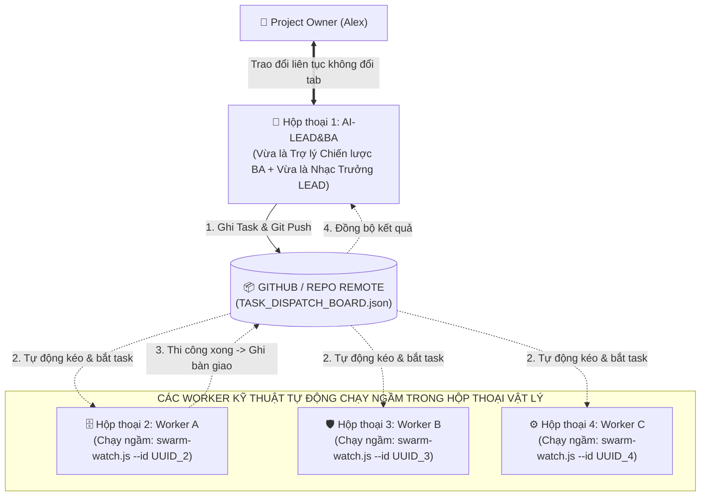

# 🚀 UNIVERSAL AI SWARM BOOTSTRAP PLAYBOOK (UASOF V3.2)
### CẨM NANG KHỞI TẠO TỔNG QUÁT: ZERO-HARDCODE GITOPS & WORKER DAEMON RUNTIME
**Dành cho Project Owner & Hệ thống AI Swarm Tự Động Hóa 100%**  
*Mã tài liệu: `UASOF-BOOTSTRAP-V3.2` | Triết lý: Dynamic UUID Binding & In-Session Physical Daemons*

---

## 🏛️ I. NGUYÊN TẮC QUẢN TRỊ BẤT BIẾN CỦA AI SWARM

Để loại bỏ hoàn toàn việc con người phải nhảy qua nhảy lại giữa các tab chat gây phân mảnh ngữ cảnh (Context Fragmentation), UASOF V3.2 thiết lập kiến trúc **Điểm Chạm Duy Nhất (Single Point of Contact - SPOC)**:



---

## 💡 II. 🚨 QUY TRÌNH THIẾT LẬP VẬT LÝ KHI KÍCH HOẠT WORKER MỚI (ZERO-HARDCODE)

Khi `AI-LEAD&BA` thông báo đến giai đoạn cần mở thêm một Worker, quy trình diễn ra không hề có bất kỳ sự hardcode nào:

### Bước 1: Mở Hộp Thoại Vật Lý & Lấy Conversation ID (UUID)
1. Người dùng bấm dấu `+` trên IDE để mở 1 Tab Chat vật lý mới cho Worker đó.
2. Tại tab mới, gõ đúng câu hỏi:
   ```text
   Conversation ID của phiên chat này là gì?
   ```
3. Con AI mới sẽ trả lời: `Mã Conversation ID của tôi là: <UUID_MỚI>`.
4. Người dùng copy mã UUID đó dán lại vào hộp thoại của `AI-LEAD&BA`.

### Bước 2: AI-LEAD&BA Đăng Bạ & Xuất Lệnh Chạy Daemon Động
1. `AI-LEAD&BA` ghi nhận UUID vào `swarm/AI_SWARM_REGISTRY.json` để khóa cứng vai trò độc quyền.
2. `AI-LEAD&BA` tự động xuất câu lệnh khởi động Daemon chứa chính mã UUID đó:
   ```bash
   node swarm/scripts/swarm-watch.js --id <UUID_MỚI> --loop --interval 15
   ```

### Bước 3: Kích Hoạt Daemon Ngay Trong Hộp Thoại Vật Lý Của Con AI Mới
1. Người dùng copy câu lệnh mà `AI-LEAD&BA` vừa sinh ra dán vào hộp thoại vật lý của con AI mới.
2. Con AI mới tự động chạy ngầm script `swarm-watch.js`.
3. Script tự động phân giải mã `<UUID_MỚI>` từ `AI_SWARM_REGISTRY.json` để biết mình đang giữ vai trò gì, không cần hardcode tên vai trò!

---

## 🛰️ III. CƠ CHẾ VẬN HÀNH TỰ ĐỘNG 100% CỦA WORKER DAEMON

Sau khi bước 3 được kích hoạt:
1. **Tự Động Kéo Git (Auto Polling)**: Cứ mỗi 15 giây, daemon tự động chạy `git pull origin main` để cập nhật trạng thái mới nhất từ repository từ xa.
2. **Tự Động Nhận Việc (Auto Claim)**: Khi phát hiện trên `swarm/TASK_DISPATCH_BOARD.json` có task được giao cho vai trò hoặc UUID của nó:
   - Daemon tự động phát chuông báo động: `🚨 [PHÁT HIỆN TÍN HIỆU TÁC VỤ MỚI CHO <UUID>]`.
   - Con Worker trong chính tab vật lý đó tự động nhận task `IN_PROGRESS`, tự đọc yêu cầu và bắt tay vào thi công!
3. **Tự Động Bàn Giao Chéo (Autonomous Handoff)**:
   - Thi công xong, Worker tự đổi trạng thái task sang `READY_FOR_AUDIT` kèm `handoff_to: "AI-AUDIT"`, tự động `git commit` và `git push`!
   - Daemon của Worker kiểm toán ở tab khác tự động bắt được tín hiệu và tự chạy kiểm toán mà người dùng không cần bấm gì cả!
4. **Báo Cáo Tự Động Về Điểm Chạm Duy Nhất**:
   - `AI-LEAD&BA` ở Tab 1 tự động kéo kết quả từ Git về và báo cáo tóm tắt cho Alex!
