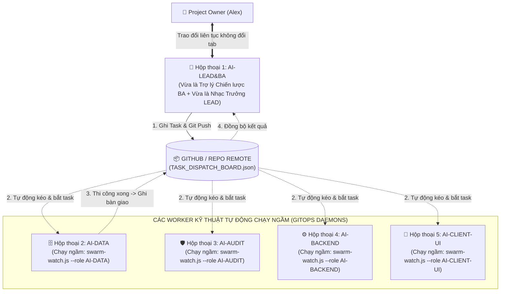

# 🚀 UNIVERSAL AI SWARM BOOTSTRAP PLAYBOOK (UASOF V3.0)
### CẨM NANG KHỞI TẠO TỔNG QUÁT: MÔ HÌNH CO-PILOT KÉP (AI-LEAD&BA) & GITOPS WORKER DAEMONS
**Dành cho Project Owner & Hệ thống AI Swarm Tự Động Hóa 100%**  
*Mã tài liệu: `UASOF-BOOTSTRAP-V3.0` | Triết lý: Single Point of Contact & Autonomous GitOps Daemons*

---

## 🏛️ I. MÔ HÌNH VẬN HÀNH CO-PILOT KÉP (AI-LEAD&BA)

Để loại bỏ hoàn toàn việc con người phải nhảy qua nhảy lại giữa các tab chat gây phân mảnh ngữ cảnh (Context Fragmentation), UASOF V3.0 thiết lập kiến trúc **Điểm Chạm Duy Nhất (Single Point of Contact - SPOC)**:



### Ưu Điểm Đột Phá:
1. **Người dùng (Alex)**: Chỉ cần chat với **DUY NHẤT 01 CON AI-LEAD&BA** trong Tab 1. Toàn bộ ý tưởng, sửa đổi yêu cầu, duyệt tính năng chỉ diễn ra ở đây.
2. **Các AI Kỹ thuật (Workers)**: Được kích hoạt ở các tab khác nhưng **KHÔNG CẦN NGƯỜI DÙNG PHẢI LÀM SHIPPER CHUYỂN TIN NHẮN**! Chúng tự động chạy ngầm kịch bản `swarm-watch.js` để tự bắt việc từ Git và tự bàn giao chéo cho nhau!

---

## 🛰️ II. CƠ CHẾ GITOPS EVENT-DRIVEN DAEMON (`swarm-watch.js`)

Khi một tác tử chuyên môn (ví dụ: `AI-DATA`) được kích hoạt trong tab chat của nó, nó chỉ cần chạy lệnh lắng nghe:

```bash
node swarm/scripts/swarm-watch.js --role AI-DATA --loop --interval 15
```

### Chu Trình Vận Hành Tự Động 100%:
1. **Kiểm tra định kỳ (Polling)**: Cứ mỗi 15-30 giây, script tự động chạy `git pull origin main` để cập nhật trạng thái mới nhất từ Git.
2. **Bắt tín hiệu tác vụ**: Script kiểm tra file `swarm/TASK_DISPATCH_BOARD.json`. Khi thấy có task được giao cho `AI-DATA` với trạng thái `ASSIGNED` hoặc `READY`:
   - Script tự động in ra màn hình thông báo: `🚨 [PHÁT HIỆN TÍN HIỆU TÁC VỤ MỚI CHO AI-DATA]`.
   - Con `AI-DATA` tự động nhận task `IN_PROGRESS`, bắt tay vào thiết kế DDL hoặc viết code.
3. **Tự động bàn giao (Autonomous Handoff)**:
   - Khi `AI-DATA` làm xong, nó đổi trạng thái task sang `READY_FOR_AUDIT` kèm `handoff_to: "AI-AUDIT"`, commit và push lên Git.
   - Script `swarm-watch.js` của tab `AI-AUDIT` lập tức phát hiện tín hiệu, đánh thức `AI-AUDIT` vào chạy kiểm toán 5 Quality Gates mà không cần con người bấm nút!
4. **Báo cáo về Nhạc Trưởng**:
   - `AI-LEAD&BA` ở Tab 1 tự động đồng bộ kết quả từ Git và thông báo cho Alex: *"Dạ anh Alex, CSDL đã được AI-DATA thiết kế và AI-AUDIT nghiệm thu PASS 100% rồi ạ!"*
