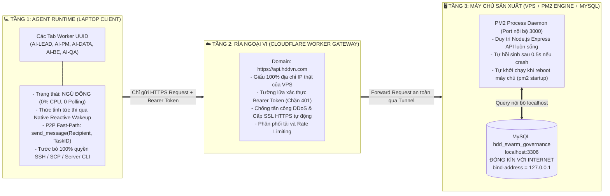

# 🛡️ ĐẶC TẢ PHÒNG THỦ 3 TẦNG DOANH NGHIỆP & QUẢN TRỊ TASK LŨY TIẾN
**ENTERPRISE THREE-TIER DEFENSE & PROGRESSIVE TASK GOVERNANCE SPECIFICATION**

- **Mã hiệu:** `UASOF-DEFENSE-3TIER-V1.0` | **Thẩm quyền:** Sếp Alex & Super Master Leader
- **Phân loại:** UNIVERSAL ARCHITECTURAL INVARIANT SPECIFICATION
- **Nền tảng học thuyết:** Hệ thống Phòng Thủ Chiều Sâu (**Defense-in-Depth**), An toàn thông tin **CIA Triad** (Confidentiality, Integrity, Availability), và Nguyên lý Thiết kế **SOLID**.

---

## 🛑 I. TỨ ĐẠI KHUYẾT TẬT HỆ THỐNG ĐÃ ĐƯỢC GIẢI MÃ & TRIỆT TIÊU

Dựa trên thực nghiệm vận hành thực địa tại các cụm dự án lớn, Framework chuẩn hóa và giải quyết dứt điểm 4 "tử huyệt" chí mạng:

```text
┌────────────────────────────────────────────────────────────────────────┐
│                   TỨ ĐẠI KHUYẾT TẬT HỆ THỐNG ĐÃ TRIỆT TIÊU             │
├───────────────────────────────────┬────────────────────────────────────┤
│ 1. QUẢ BOM CONTEXT 460 KB:        │ 2. VÒNG LẶP POLLING NGHẼN MÁY:     │
│ File JSON đơn khối 5.726 dòng     │ Bắt Worker chạy `swarm-watch.js`   │
│ ngốn 115k tokens -> Gây suy thoái │ vòng lặp 15s/lần -> Làm nóng máy   │
│ chú ý và Action Hallucination.    │ laptop và spam socket mạng VPS.    │
├───────────────────────────────────┼────────────────────────────────────┤
│ 3. LỘ CỔNG MYSQL 3306 & ROLE CREEP:│ 4. TRANH CHẤP MERGE CONFLICT:      │
│ Mở port raw ra Internet dễ bị dò  │ Nhiều Worker cùng ghi đè vào 1     │
│ pass; PM tự tiện gõ SCP/SSH làm   │ file JSON dồn tích -> Khóa Git     │
│ hỏng máy chủ sản xuất.            │ index.lock, tê liệt toàn đàn.      │
└───────────────────────────────────┴────────────────────────────────────┘
```

---

## 🏛️ II. MÔ HÌNH PHÒNG THỦ 3 TẦNG CHIỀU SÂU (DEFENSE-IN-DEPTH MATRIX)

Áp dụng cho các dự án cấp Doanh nghiệp có hạ tầng máy chủ và cơ sở dữ liệu (**Mode B Enterprise**):



### 3 Đặc Tính Cốt Tử Của Mô Hình:
1. **Triệt tiêu 100% Role Creep (Không cấp quyền SSH cho AI):**
   - Toàn bộ Agent chỉ giao tiếp với thế giới bên ngoài qua REST API siêu nhẹ của Cloudflare Gateway.
   - Agent không biết địa chỉ IP thật của máy chủ, không sở hữu SSH Private Key $\rightarrow$ Không thể tự ý gõ lệnh `scp`, `ssh`, hay `systemctl` làm hỏng server.
2. **Khả năng tự hồi phục bất tử (High Availability & Self-Healing):**
   - Nếu tiến trình API bị lỗi cú pháp tạm thời hoặc rò rỉ bộ nhớ, **PM2 tự động restart trong 0.5 giây**.
   - Nếu VPS bị khởi động lại, `pm2 startup` tự động phục hồi toàn bộ dịch vụ.
3. **Đóng kín bề mặt tấn công (Zero Attack Surface):**
   - Cổng CSDL MySQL 3306 được cấu hình `bind-address = 127.0.0.1`.
   - Cổng 3306 hoàn toàn vô hình trước toàn bộ máy quét cổng trên Internet, triệt tiêu 100% rủi ro bị tấn công brute-force mật khẩu.

---

## 🗄️ III. QUY CHUẨN ĐIỀU PHỐI TASK LŨY TIẾN 2 CHẾ ĐỘ (PROGRESSIVE TASK GOVERNANCE)

Hệ thống loại bỏ hoàn toàn việc áp đặt một mô hình cứng nhắc, cho phép chuyển đổi mượt mà theo quy mô dự án:

```text
                                 ┌─────────────────────────────────┐
                                 │       BẮT ĐẦU PHIÊN CHAT        │
                                 │  - Nạp AGENTS.md tối giản       │
                                 │  - Nạp .agents/rules/           │
                                 └────────────────┬────────────────┘
                                                  │
                                                  ▼
                                 ┌─────────────────────────────────┐
                                 │  KHẢO SÁT HẠ TẦNG (ONBOARDING)   │
                                 │  Hỏi Sếp: Mode A hay Mode B?    │
                                 └────────┬───────────────┬────────┘
                                          │               │
                     KHÔNG CÓ DATABASE    │               │  CÓ MYSQL / VPS ENTERPRISE
                                          ▼               ▼
 ┌──────────────────────────────────────────────┐   ┌──────────────────────────────────────────────┐
 │   MODE A: GITOPS PHÂN MẢNH (NO DATABASE)     │   │     MODE B: DOANH NGHIỆP ENTERPRISE (MYSQL)  │
 ├──────────────────────────────────────────────┤   ├──────────────────────────────────────────────┤
 │ - Dành cho dự án độc lập, chạy offline.      │   │ - Dành cho cụm dự án lớn (như HDD Enterprise)│
 │ - Mỗi task là 1 file riêng:                  │   │ - Nguồn sự thật (SSOT): CSDL MySQL 29 Bảng   │
 │   swarm/tasks/active/TASK-xxx.json (< 2 KB). │   │   và 11 Views (HDD_SWARM_GOVERNANCE_...sql). │
 │ - Worker CHỈ ĐỌC ĐÚNG 1 FILE ĐƯỢC GIAO.      │   │ - Agent nhận task qua REST API Gateway hoặc  │
 │ - Hoàn thành -> Chuyển sang tasks/archive/   │   │   truy vấn SQL siêu nhẹ (< 1 KB / < 150 tok).│
 │ - swarm/BOARD_SUMMARY.json chỉ tóm tắt KPI   │   │ - 0% xung đột Git, không phụ thuộc file JSON,│
 │   tổng quan (< 50 dòng).                     │   │   Workers ngủ đông, thức giấc bằng P2P.      │
 └──────────────────────────────────────────────┘   └──────────────────────────────────────────────┘
```

---

## 📊 IV. BẢNG SO SÁNH ĐỊNH LƯỢNG GIỮA CÁC MÔ HÌNH

| Tiêu chí | Mô hình Cũ (Monolith 460 KB) | Mode A (GitOps Phân Mảnh) | Mode B (Enterprise 3-Tier) |
| :--- | :--- | :--- | :--- |
| **Dung lượng nạp mỗi Task** | ~460 KB (~115.000 tokens) | < 2 KB (~400 tokens) | **< 1 KB (~150 tokens)** |
| **Tỷ lệ tiết kiệm Token** | 0% (Nguy cơ tràn context) | Tiết kiệm 99.6% | **Tiết kiệm 99.8%** |
| **Trạng thái Worker khi rảnh** | Chạy polling 15s/lần (Tốn CPU) | Chạy polling nhẹ cục bộ | **Ngủ đông 100% (0% CPU, 0 Polling)** |
| **Xung đột Git (Merge Conflict)**| Rất cao khi nhiều Worker push | Rất thấp (Mỗi task 1 file) | **Hoàn toàn bằng 0** (Lưu CSDL) |
| **Bảo mật máy chủ VPS** | Lộ port 3306, AI có quyền SSH | Không dùng máy chủ | **Đóng kín port 3306, giấu IP qua Cloudflare** |
| **Cơ chế đánh thức** | Quét file dồn tích liên tục | Quét thư mục `tasks/active/` | **P2P Fast-Path `send_message` Native** |

---

## 🛡️ V. ĐỐI SOÁT MA TRẬN 16 TIÊU CHUẨN AN TOÀN (CIA TRIAD & SOLID)

| Biện pháp | Chuẩn Bảo mật | Thực thi trong Kiến trúc Phòng thủ 3 Tầng |
| :--- | :---: | :--- |
| **Biện pháp 1 & 2** (Git Local & Remote) | `CIA-I`, `CIA-A` | Toàn bộ mã nguồn code được commit và đẩy lên Git Private; CSDL được backup tự động định kỳ. |
| **Biện pháp 3** (Sổ việc chung SSOT) | `SOLID-S`, `CIA-I` | Nguồn chân lý duy nhất là bảng `Project_Tasks` trên MySQL; khai tử vĩnh viễn file đơn khối 460 KB. |
| **Biện pháp 6 & 7** (Bằng chứng nhị phân) | `CIA-I` | Mọi nghiệm thu bắt buộc có Git commit SHA, ảnh chụp E2E thật; cấm ảo giác "đúng 100%". |
| **Biện pháp 9** (Bảo vệ thông tin nhạy cảm) | `CIA-C` | Đóng kín cổng 3306; cấm cấp SSH Key cho Agent; toàn bộ giao tiếp xác thực qua Bearer Token. |
| **Biện pháp 13** (Ghi file riêng biệt) | `Microservices`, `CIA-I` | Mode A: Mỗi task 1 file riêng; Mode B: Mỗi Worker cập nhật record riêng trong CSDL, triệt tiêu xung đột. |
| **Biện pháp 14 & 15** (Ngủ đông & 0 Token lãng phí) | `CIA-A` | Triệt tiêu vòng lặp `swarm-watch.js --loop` ở Mode B; Worker ngủ đông 0% CPU, thức giấc qua P2P Fast-Path. |
| **Biện pháp 16** (Thay ca session động) | `SOLID-D`, `CIA-A` | Tái tạo context sạch khi chạm ngưỡng 50k tokens bằng `recycle_worker.py` hoặc Native turnover. |

---

## 📌 VI. CHỈ THỊ THỰC THI BẮT BUỘC (ARCHITECTURAL DIRECTIVE)

1. **Đối với các Agent cấp dưới:**
   - Nghiêm cấm mọi hành vi gọi tool `read_file` trên các tệp JSON có dung lượng > 45 KB.
   - Nghiêm cấm việc yêu cầu cấp quyền SSH, SCP hoặc tự ý gõ lệnh can thiệp máy chủ VPS.
2. **Đối với các Quản trị viên Dự án (PM / Lead):**
   - Dự án không có CSDL: Bắt buộc cấu hình Mode A (`swarm/tasks/active/` và `swarm/BOARD_SUMMARY.json`).
   - Dự án Doanh nghiệp: Bắt buộc kích hoạt Mode B, nạp schema từ `docs/database/HDD_SWARM_GOVERNANCE_FULL_DDL.sql`, kết nối qua Cloudflare Gateway và đóng kín cổng 3306 của máy chủ.
