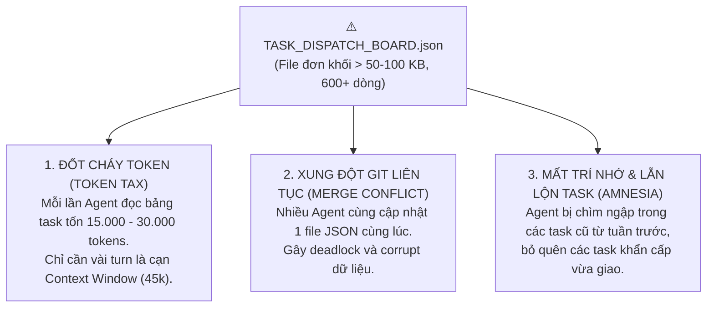

# 🚀 HƯỚNG DẪN NÂNG CẤP & TỰ ĐỘNG PHÂN RÃ TASK ĐƠN KHỐI (MONOLITH TO PARTITIONED GITOPS)
**Mã tài liệu:** `GUIDE-MIGRATE-MONOLITH-TO-PARTITIONED-001`  
**Thuộc thẩm quyền:** `[[SUPER MASTER LEADER]]` - Universal AI Swarm Framework  
**Áp dụng:** Toàn bộ các dự án con vận hành theo **Mode A (Partitioned GitOps)**.

---

## I. TẠI SAO PHẢI KHAI TỬ BẢNG TASK ĐƠN KHỐI (`TASK_DISPATCH_BOARD.json`)?

Trong các dự án ban đầu (như repo `VPS`), toàn bộ các công việc từ ngày đầu tiên tới hiện tại được dồn tích lũy vào một tệp duy nhất: `swarm/TASK_DISPATCH_BOARD.json`. 

Khi dự án chạy dài ngày (hàng chục đến hàng trăm task), tệp này phình to từ 600 dòng đến hàng nghìn dòng (> 50 KB – 100 KB). Điều này tạo ra **3 THẢM HỌA HỆ THỐNG**:



Theo **Điều V Hiến Pháp Bất Biến (AGENTS.md)**:
> *"CẤM ĐỌC FILE LỚN > 45 KB: Tuyệt đối CẤM Agent gọi tool `read_file` trên các tệp JSON danh bạ/task dồn tích có dung lượng lớn hơn 45 KB. Mọi tệp monolithic `TASK_DISPATCH_BOARD.json` cũ phải được backup và phân mảnh thành các tệp mỏng < 2 KB."*

---

## II. KIẾN TRÚC PHÂN RÃ MỚI (PARTITIONED GITOPS ARCHITECTURE)

Sau khi phân rã, thư mục `swarm/` sẽ có cấu trúc module hóa siêu nhẹ:

```
swarm/
├── BOARD_SUMMARY.json           <-- Snapshot KPI tổng hợp (< 1 KB, ~150 tokens)
├── TASK_DISPATCH_BOARD.json     <-- Con trỏ chuyển hướng mỏng (< 500 bytes)
├── TASK_DISPATCH_BOARD.json.monolith.bak <-- Bản sao lưu an toàn 100% dữ liệu cũ
└── tasks/
    ├── active/                  <-- Chứa các file task ĐANG THI CÔNG (< 2 KB/file)
    │   ├── TASK-VPS-PROD-010.json
    │   └── TASK-VPS-DEPLOY-025.json
    └── archive/                 <-- Chứa các file task ĐÃ HOÀN THÀNH (< 2 KB/file)
        ├── TASK-VPS-PROD-001.json
        └── TASK-VPS-PROD-002.json
```

### Ưu điểm vượt trội:
1. **Tiết kiệm 95% token**: Worker chỉ đọc đúng 1 file task của mình (`< 2 KB`, tiêu tốn < 200 tokens thay vì 20.000 tokens).
2. **Triệt tiêu xung đột Git**: Mỗi Agent ghi vào một file riêng biệt.
3. **Hiệu năng cực nhanh**: IDE không bao giờ bị khựng lag hay tràn bộ nhớ.

---

## III. HƯỚNG DẪN 1 LỆNH DI TẢN DUY NHẤT (ZERO-EFFORT MIGRATION)

Framework Master đã trang bị sẵn công cụ di tản tự động thông minh: `task-partition-manager.js`.

### Bước 1: Kéo cập nhật mới nhất từ Master Framework về dự án con
Tại thư mục gốc của dự án con (ví dụ: `c:\Projects\VPS`), chạy:
```powershell
git pull origin main
```
*(Hoặc sao chép file `swarm/scripts/task-partition-manager.js` từ Master Framework sang dự án con).*

### Bước 2: Chạy lệnh di tản tự động
Chạy duy nhất một dòng lệnh sau trong Terminal:
```powershell
node swarm/scripts/task-partition-manager.js migrate
```
*(Hoặc dùng: `node swarm/scripts/gov-client.js migrate-monolith`)*

### Kết quả script sẽ tự động thực hiện:
* ✅ Tự nhận diện cấu trúc file `TASK_DISPATCH_BOARD.json`.
* ✅ Tự động phân tách: Đưa toàn bộ task `COMPLETED` / `ARCHIVED` vào `swarm/tasks/archive/`.
* ✅ Đưa các task `OPEN` / `IN_PROGRESS` / `READY_FOR_AUDIT` vào `swarm/tasks/active/`.
* ✅ Tự động tạo bản backup `TASK_DISPATCH_BOARD.json.monolith.bak`.
* ✅ Thay thế `TASK_DISPATCH_BOARD.json` thành file con trỏ mỏng nhẹ.
* ✅ Sinh file `swarm/BOARD_SUMMARY.json` cập nhật thời gian thực.

---

## IV. CẨM NANG VẬN HÀNH SAU KHI PHÂN RÃ DÀNH CHO AGENTS

| Thao tác | Câu lệnh Terminal | Ý nghĩa |
| :--- | :--- | :--- |
| **Xem danh sách task active** | `node swarm/scripts/task-partition-manager.js list` | Liệt kê nhanh toàn bộ việc đang chạy |
| **Tạo task mới** | `node swarm/scripts/task-partition-manager.js create TASK-001 "Tiêu đề" AI-WORKER` | Tạo file task mới trong `active/` |
| **Worker nhận việc** | `node swarm/scripts/task-partition-manager.js claim TASK-001 AI-WORKER` | Chuyển trạng thái sang `IN_PROGRESS` |
| **Nghiệm thu & Lưu trữ** | `node swarm/scripts/task-partition-manager.js archive TASK-001` | Chuyển task sang `archive/` và update KPI |
| **Xem bảng KPI tổng hợp** | `node swarm/scripts/task-partition-manager.js summary` | Xuất JSON snapshot mỏng nhẹ |

---

## V. ĐIỀU KHOẢN HIẾN PHÁP BẮT BUỘC KHI ĐỌC TASK

1. **Worker chỉ đọc đúng 1 file:**
   Worker chỉ được gọi `read_file` trên:
   `swarm/tasks/active/<TASK_ID>.json`
   Tuyệt đối **CẤM** đọc file backup `TASK_DISPATCH_BOARD.json.monolith.bak` hoặc đọc toàn bộ thư mục `archive/`.

2. **Lead / PM giám sát qua file Summary:**
   Lead và PM theo dõi tiến độ tổng thể qua `swarm/BOARD_SUMMARY.json` (< 1 KB) thay vì đọc từng file task.
