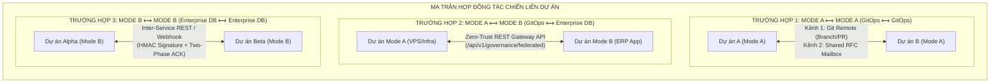
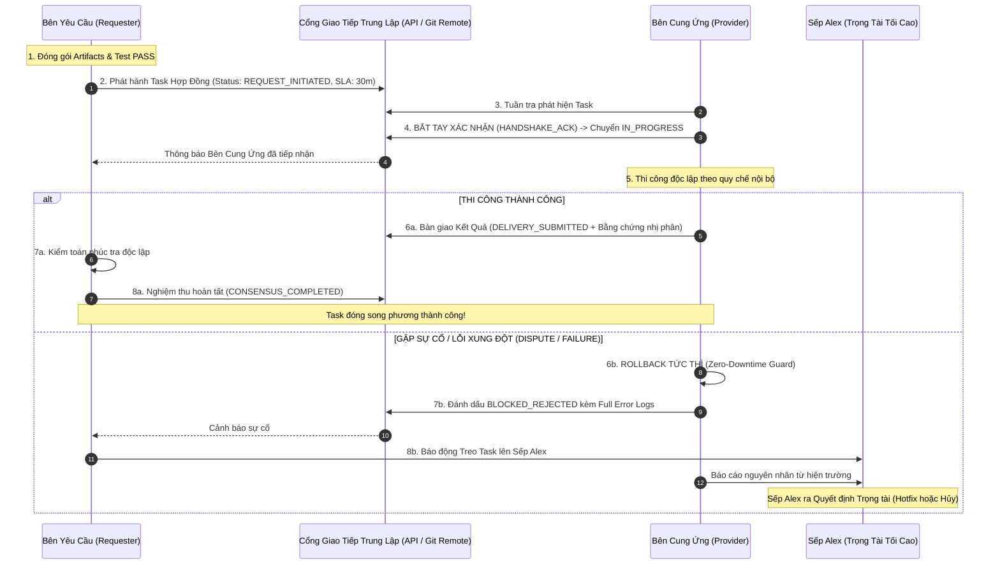

# 🌐 GIAO THỨC TÁC CHIẾN & ĐỒNG THUẬN LIÊN DỰ ÁN (UNIVERSAL CROSS-PROJECT FEDERATED SWARM PROTOCOL - CPFSP)
**Mã tài liệu:** `RFC-FEDERATED-CROSS-PROJECT-001`  
**Cấp độ:** Kiến trúc Thượng nguồn Tối cao (Super Master Meta-Architecture)  
**Tác giả:** `[[SUPER MASTER LEADER]]` & Sếp Alex  
**Trạng thái:** `APPROVED_IMMUTABLE_STANDARD`

---

## I. BỐI CẢNH & NGUYÊN LÝ CHỦ QUYỀN NGỮ CẢNH TUYỆT ĐỐI

Trong thực tế vận hành Swarm đa dự án, mỗi dự án là một thực thể độc lập có môi trường, hạ tầng và triết lý quản trị riêng:
* **Dự án Mode A (GitOps-Centric):** Quản lý qua Git repository, phân mảnh task files (`swarm/tasks/active/*.json`), vận hành offline-first, gọn nhẹ, không phụ thuộc CSDL bên ngoài.
* **Dự án Mode B (Database-Centric SSOT):** Quản lý qua CSDL tập trung MySQL/Postgres và REST API Gateway, phân cấp quyền hạn chặt chẽ, truy vấn thời gian thực.

### ⚠️ 3 Căn bệnh chí mạng khi phối hợp liên dự án (The 3 Anti-Patterns):
1. **Bệnh "Xâm lược đĩa vật lý" (Cross-Workspace Disk Poisoning):** Một bên dùng script Node.js (`fs.writeFileSync`, child_process) tự tiện ghi đè file vào ổ đĩa của dự án khác. Hậu quả: Bypass Git, tạo file untracked, phá vỡ working tree của đối tác, xung đột `git merge`, tiềm ẩn lỗ hổng bảo mật.
2. **Bệnh "Giao tiếp một chiều & Mất thông tin" (Fire-and-Forget Amnesia):** Dự án này bơm task sang dự án kia nhưng không có bước xác nhận nhận việc (Handshake ACK) và không có kênh nhận phản hồi. Khi có lỗi (conflict, build fail, migration timeout), task bị treo vô tận (hung task).
3. **Bệnh "Dẫm chân thẩm quyền" (Role & Scope Usurpation):** Bên ứng dụng tự ý cấu hình hạ tầng; bên hạ tầng tự ý sửa mã nguồn nghiệp vụ. Hai bên tranh giành quyền kiểm soát dẫn đến tê liệt hệ thống.

### 🛡️ Nguyên lý Cốt lõi: Chủ quyền Ngữ cảnh Bất khả Xâm phạm (Contextual Sovereignty Invariant)
> *"Mỗi dự án Swarm là một thực thể có chủ quyền độc lập. TUYỆT ĐỐI CẤM bất kỳ Agent hoặc Script nào của Dự án X được phép đọc/ghi trực tiếp vào hệ thống tệp cục bộ (Local Disk I/O) của Dự án Y. Mọi sự hợp tác tác chiến bắt buộc phải đi qua Giao Tiếp Trung Lập Phi Xâm Lấn (Non-Intrusive Neutral Interfaces) và tuân thủ Hợp Đồng Dịch Vụ Song Phương (Bi-directional Service Contract) có cơ chế đồng thuận 3 bên."*

---

## II. MA TRẬN PHỐI HỢP LIÊN DỰ ÁN (THE 3-MATRIX FEDERATED TOPOLOGIES)

### 1. Ma trận 1: Mode A $\longleftrightarrow$ Mode A (GitOps thuần với GitOps thuần)
* **Kênh trao đổi mã nguồn & dữ liệu:** Git Remote trung gian (GitHub/GitLab) thông qua Release Tags, Release Branches hoặc Pull Requests.
* **Kênh trao đổi tác vụ:** **Shared Git Mailbox Protocol**. Mỗi bên duy trì thư mục `swarm/mailbox/inbox/` và `swarm/mailbox/outbox/`. Giao dịch tác vụ được đóng gói thành các file RFC JSON commit lên Git.
* **Quy tắc:** Không bên nào được can thiệp vào máy local của bên nào; mọi thứ được kéo (`git pull`) và đẩy (`git push`) qua Git Remote chính thức.

### 2. Ma trận 2: Mode A $\longleftrightarrow$ Mode B (GitOps phân mảnh $\longleftrightarrow$ Enterprise Database SSOT)
*Đây là trường hợp điển hình giữa ERP (`HDD-AI-ERP` - Mode B) và VPS (`vps-management` - Mode A).*
* **Bên Mode B (ERP):** 
  - Đóng vai trò **Service Consumer / Client**.
  - Muốn yêu cầu Mode A triển khai hạ tầng: Mode B **push mã nguồn lên GitHub Master** $\implies$ Phát hành bản ghi `TASK_DEPLOY` trên CSDL MySQL SSOT qua endpoint nội bộ.
  - **LỆNH CẤM:** Cấm 100% việc viết file vào ổ đĩa của Mode A.
* **Bên Mode A (VPS):**
  - Đóng vai trò **Infrastructure Service Provider**.
  - Vận hành Daemon tuần tra (`federated-bridge.js` hoặc `gov-client.js patrol-federated`) chọc qua **REST Gateway API** của Mode B để kéo task.
  - Khi nhận được task: Mode A tự sinh file task phân mảnh nội bộ `swarm/tasks/active/TASK-xxx.json` của mình để điều phối lính DevOps nội bộ thi công.
  - Khi thi công xong: Mode A gọi REST API nộp kết quả kèm Deliverables và Bằng chứng nhị phân (`ProofUrl`, `ProofHash`, `Verdict`) để Mode B nghiệm thu.

### 3. Ma trận 3: Mode B $\longleftrightarrow$ Mode B (Enterprise CSDL này với Enterprise CSDL khác)
* **Kênh giao tiếp:** REST API Gateway bảo mật hoặc Event Bus (Webhook có chữ ký số HMAC-SHA256).
* **Quy trình:**
  - Dự án phát lệnh (Requester) gửi Webhook/POST sang Gateway của Dự án nhận lệnh (Provider).
  - Provider trả về `202 Accepted` kèm `CorrelationId` (Handshake ACK).
  - Provider thực thi nội bộ và bắn Callback Webhook trả kết quả kèm bằng chứng nhị phân khi hoàn thành.
  - Tuyệt đối cấm kết nối trực tiếp chuỗi JDBC/MySQL xuyên CSDL để tránh nghẽn Connection Pool và vỡ transaction.

---

## III. VÒNG ĐỜI HỢP ĐỒNG DỊCH VỤ 5 BƯỚC (5-STAGE BI-DIRECTIONAL SERVICE LIFECYCLE)

Để triệt tiêu vĩnh viễn nguy cơ **treo task (hung tasks)** và **mất thông tin**, mọi giao dịch liên dự án bắt buộc phải tuân thủ FSM 5 trạng thái có phản hồi bắt buộc:

---

## IV. BỐN NGUYÊN TẮC BẢO CHỨNG ĐỒNG THUẬN (ANTI-HANG GUARANTEES)

### 1. Nguyên Tắc Bắt Tay Hai Chiều (Mandatory Handshake ACK)
* Cấm tuyệt đối kiểu bắn lệnh một chiều rồi bỏ mặc (Fire-and-Forget).
* Bên yêu cầu sau khi tạo task phải nhận được tín hiệu `HANDSHAKE_ACK` trong vòng **15 phút**.
* Nếu quá 15 phút không có ACK $\implies$ Hệ thống kích hoạt cảnh báo: *"Provider Swarm Offline hoặc Watcher Daemon bị kẹt"*.

### 2. Nguyên Tắc Ngắt Mạch SLA (Circuit Breaker Timeout)
* Mọi hợp đồng tác chiến liên dự án đều phải có thời hạn hoàn thành (mặc định SLA: **30 phút** cho Deploy/Sync).
* Nếu task kẹt ở `IN_PROGRESS` quá 30 phút mà không có cập nhật tiến độ $\implies$ FSM tự động ngắt mạch chuyển sang **`BLOCKED_SUSPENDED`**, cấm đóng bừa trên giấy và gửi tín hiệu cứu viện tới Tổng Chỉ Huy (Sếp Alex).

### 3. Nguyên Tắc "Bất Đồng Thuận = Rollback Tức Thì" (Rollback-First Dispute Rule)
* Khi bên Cung Ứng (ví dụ VPS) kéo mã nguồn hoặc DDL migrations của bên Yêu Cầu (ERP) mà gặp bất kỳ lỗi nào (`npm build fail`, syntax error, migration deadlock, test timeout):
  * Bên Cung Ứng **LẬP TỨC ROLLBACK** về commit an toàn gần nhất, bảo vệ 100% môi trường Live không bị sập.
  * Xuất toàn bộ log lỗi nhị phân trả ngược về cho bên Yêu Cầu.
  * Tuyệt đối cấm tự ý sửa code nghiệp vụ của bên bạn trên môi trường Live.

### 4. Vị Thế Trọng Tài Tối Cao Của Sếp Alex (Supreme Arbitrator Invariant)
* Sếp Alex nắm quyền kiểm soát bảng điều khiển chiến lược tối cao.
* Khi hai bên gặp tranh chấp hoặc task rơi vào `BLOCKED_SUSPENDED`, không bên nào được tự ý đổ lỗi. Cả hai bên phải nộp báo cáo nhị phân (logs thật) để Sếp Alex ra quyết định phân xử dứt điểm.
